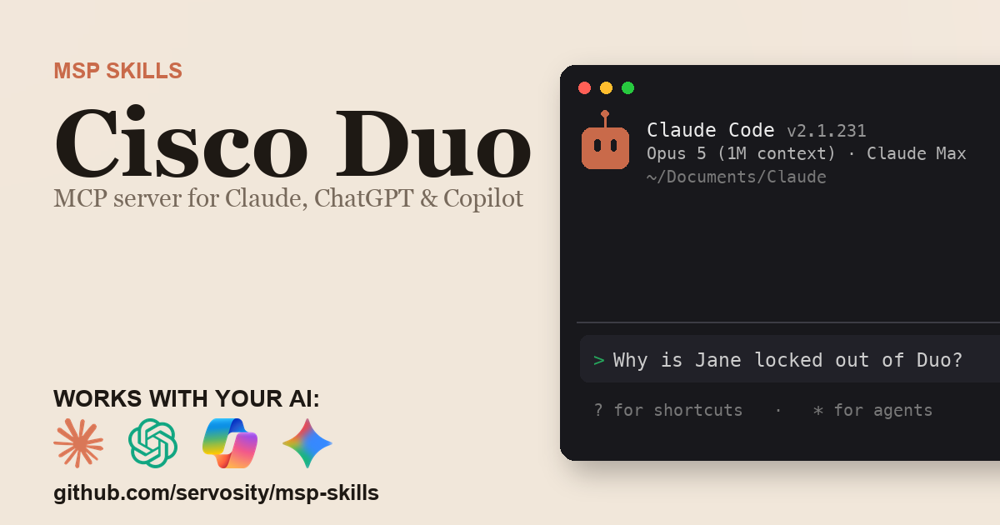

# Cisco Duo + AI - for ChatGPT, Claude, GitHub Copilot, Microsoft 365 Copilot, Gemini, and any agent that speaks MCP

> Unofficial. Community-built Claude Code Skill and MCP server for the Cisco Duo
> API. Not affiliated with, endorsed by, or sponsored by Cisco Systems, Inc.

<!-- media:start -->
<p align="center">
  <a href="https://msp-skills.compoundingteams.com/skills/cisco-duo/">
    
  </a>
</p>
<p align="center"><sub><a href="https://msp-skills.compoundingteams.com/skills/cisco-duo/">Full skill page</a> - install, outcomes, safety model.</sub></p>
<!-- media:end -->

Fix Duo MFA lockouts in one command and see every MSP subaccount at once, with signed Admin API calls. Works with the AI you already use - **ChatGPT** (Plus/Pro+), **Claude Desktop**, **Codex**, **Claude Code**, **Claude Cowork**, and **GitHub Copilot** - plus **Microsoft 365 Copilot / Copilot Studio** and **Google Gemini** via the remote path. Free, open source, runs on your laptop. Built for MSP owners. No code required.

## Works with your agent

The six agents MSP owners actually use (works today; ChatGPT also needs an OAuth gateway, see below):

| Your AI agent | How to install the Cisco Duo skill |
| --- | --- |
| **Claude Desktop** | Run installer, then **Settings > Extensions** to register `cisco-duo-mcp` (no JSON editing). |
| **ChatGPT** (paid plans) | Run installer, expose `cisco-duo-mcp` over HTTPS behind an OAuth gateway, register as a Developer Mode connector. |
| **Codex CLI** | Paste the install prompt below. |
| **Claude Code** | Paste the install prompt below. |
| **Claude Cowork** | Paste the install prompt below. |
| **GitHub Copilot** (VS Code) | Run installer, add `cisco-duo-mcp` to `mcp.json` under the `servers` key, then pick **Agent** mode. |

For ChatGPT, set `CISCO_DUO_MCP_HTTP_TOKEN` and run `cisco-duo-mcp --transport http` (it refuses to start without the token, and every client must send it as `Authorization: Bearer`), then expose that behind HTTPS - no bridge package is needed. ChatGPT connectors sign in with OAuth or not at all and cannot send that bearer token, so ChatGPT also needs an OAuth-capable gateway in front of the endpoint that adds it. See [mcp-install.md](./mcp-install.md).

### Also for the Microsoft and Google stacks

Big install base, but an honest heads-up: these are the **remote / enterprise** path, not the local binary you just installed.

| Agent | What it takes |
| --- | --- |
| **Microsoft 365 Copilot / Copilot Studio** | **Not self-serve.** Host `cisco-duo-mcp` over HTTPS, then wire it into Copilot Studio (**Tools > Add a tool > Model Context Protocol > Server URL**) or a declarative agent. Needs a Copilot Studio license + tenant admin. See [mcp-install.md](./mcp-install.md). |
| **Google Gemini** | **Gemini CLI** is local - same as Claude Code. The **Gemini app** is remote - same HTTPS path as ChatGPT. See [mcp-install.md](./mcp-install.md). |

> **Skill-native agents (also covered):** [Hermes](https://hermes-agent.nousresearch.com) and [OpenClaw](#install-for-openclaw) read this skill's `SKILL.md` directly *and* speak MCP - see their install sections below. Also works with Cursor, Windsurf, Cline, Continue.dev, and Zed via MCP. Full per-tool wire-up: **[docs/which-agent.md](../../docs/which-agent.md)**.

> **Run more than one agent?** Install across all 51+ supported agents in one command: `npx skills add Servosity/msp-skills@latest` (requires Node.js, then run the per-skill installer for the CLI/MCP binaries). See [docs/which-agent.md](../../docs/which-agent.md#install-across-all-your-agents-at-once).

## Install in 60 seconds

### Fastest for Claude Desktop - one-click `.mcpb`

[**Download Cisco Duo MCP (.mcpb)**](https://github.com/servosity/msp-skills/releases/download/cisco-duo-v0.1.0/cisco-duo-mcp.mcpb) - then open **Claude Desktop > Settings > Extensions** and select the file. One click, no JSON, no shell. (Browse every Cisco Duo release on the [releases page](https://github.com/servosity/msp-skills/releases?q=cisco-duo).)

Prefer the Claude Code plugin? Add the marketplace once, then install - works immediately, no directory listing required:

```
/plugin marketplace add Servosity/msp-skills
/plugin install cisco-duo@msp-skills
```

### Path A - paste one prompt into your AI agent (recommended)

Copy this into **Claude Code**, **Codex CLI**, or **Claude Cowork**:

> Install the Cisco Duo Skill and MCP server from Servosity/msp-skills in this agent workspace. If this workspace uses a POSIX shell (macOS, Linux, WSL, or Bash), run `bash <(curl -fsSL https://raw.githubusercontent.com/Servosity/msp-skills/main/skills/cisco-duo/install.sh)`. If it uses Windows PowerShell, run `iwr -useb https://raw.githubusercontent.com/Servosity/msp-skills/main/skills/cisco-duo/install.ps1 | iex`. Then authenticate per the README and run `cisco-duo-cli --help` to explore.

The same prompt works in any agent that can run shell.

### Path B - run the installer yourself

**Windows (PowerShell):**

```powershell
iwr -useb https://raw.githubusercontent.com/Servosity/msp-skills/main/skills/cisco-duo/install.ps1 | iex
```

**macOS / Linux:**

```bash
bash <(curl -fsSL https://raw.githubusercontent.com/Servosity/msp-skills/main/skills/cisco-duo/install.sh)
```

The installer drops both `cisco-duo-cli` (the CLI) and `cisco-duo-mcp` (the MCP server) into your user bin path. Claude Code, Codex, and Cowork discover the Skill via `SKILL.md` in this directory.

Verify:

```bash
cisco-duo-cli --version
```

### Upgrade to the latest version

The installer always fetches the current release - re-run it to upgrade:

**macOS / Linux:**

```bash
bash <(curl -fsSL https://raw.githubusercontent.com/Servosity/msp-skills/main/skills/cisco-duo/install.sh)
```

**Windows (PowerShell):**

```powershell
iwr -useb https://raw.githubusercontent.com/Servosity/msp-skills/main/skills/cisco-duo/install.ps1 | iex
```

Claude Desktop `.mcpb` users: download the latest `.mcpb` (top of this section) and re-select it in **Settings > Extensions**. Claude Code plugin users: `/plugin update cisco-duo@msp-skills`.

### Add to Claude Desktop, GitHub Copilot, Gemini CLI, Microsoft 365 Copilot, or another MCP client

After the installer runs, see **[mcp-install.md](./mcp-install.md)** and **[docs/which-agent.md](../../docs/which-agent.md)** for the per-agent wire-up - one section per agent, including the GitHub Copilot `servers` key and the remote Microsoft 365 Copilot / Copilot Studio path. Claude Desktop's Settings > Extensions panel is the simplest path; the MCP config block (for users who prefer editing JSON) is documented in mcp-install.md.

<!-- pp-hermes-install-anchor -->
### Install for Hermes

From the Hermes CLI:

```bash
hermes skills install servosity/msp-skills/skills/cisco-duo --force
```

Inside a Hermes chat session:

```
/skills install servosity/msp-skills/skills/cisco-duo --force
```

Hermes [speaks MCP natively](https://hermes-agent.nousresearch.com), so it can also use the `cisco-duo-mcp` server directly - same install path, same env vars.

### Install for OpenClaw

Tell your OpenClaw agent (copy this):

> Install the cisco-duo skill from https://github.com/servosity/msp-skills/tree/main/skills/cisco-duo. The skill defines how its required CLI (`cisco-duo-cli`) can be installed via the `openclaw:` frontmatter block.

OpenClaw isn't generally available yet; the frontmatter wiring is pre-shipped and will activate the moment OpenClaw launches.

### Authenticate

In the Duo Admin Panel, go to **Applications > Protect an Application > Admin API** and create an Admin API application. An MSP creates it in the **parent** account and grants subaccount permissions. Copy its three values:

```bash
export CISCO_DUO_API_HOST="api-XXXXXXXX.duosecurity.com"   # API hostname
export CISCO_DUO_IKEY="<integration key>"
export CISCO_DUO_SKEY="<secret key>"
cisco-duo-cli doctor
```

`doctor` checks the API host, then sends one signed read (`GET /admin/v1/users?limit=1`) and reports the credential as `valid`, `rejected` (HTTP 401), or `scope-limited` (HTTP 403: the application lacks `Grant resource - Read`). It exits 0 by default; scripts should add `--fail-on error` (fails on a rejected key) or `--fail-on warn` (also fails on a scope-limited one). The secret key only signs requests; it is never sent to Duo.

Grant only the permissions your workflow needs: read-only work needs `Grant resource - Read`, `Grant read log` and `Grant read information`; as an MSP, `--account-id` and the fleet commands also need `Grant accounts - Read`, and `fleet summary`'s user-limit column needs `Grant user limits - Read`. Unlocking users, issuing bypass codes and swapping phones add `Grant resource - Write`. See [governance.md](./governance.md).

### Work with one customer, or all of them

As an MSP, add `--account-id` to any command (a subaccount ID, or its exact name from `accounts list`) or set `CISCO_DUO_ACCOUNT_ID`. The CLI looks the customer up in your parent account, sends the request to that customer's own API host, and keeps a separate local store per customer. That store is keyed by exactly what you pass, so pick one form per customer and stick to it (the account ID is safest): a sync run with the name and an audit run with the ID read different stores. `fleet summary`, `fleet risk` and `fleet find-user` always cover every customer.

### Sync before you audit

`audit bypass`, `audit stale` and `search` read a local mirror. Populate it once per tenant:

```bash
cisco-duo-cli sync --resources users,admins,phones,bypass_codes --account-id DA9VZOC5X63I2W72NRP9
```

`sync` only reads from Duo and writes a SQLite file under your user account. The audits report `complete=false` when a resource they need was never synced or its last sync stopped part-way, so an empty result is never mistaken for a clean tenant. The lockout, phone-swap, fleet and failures commands always read live.


## What this skill does

| Question your MSP keeps asking | Command |
| --- | --- |
| Why can't this user get through Duo, and which fix applies? | `cisco-duo-cli lockout triage "jane@example.com" --account-id "Acme Corp"` |
| Unlock them and give them a one-hour, single-use bypass code (preview first) | `cisco-duo-cli lockout fix "jane@example.com" --account-id "Acme Corp" --bypass` |
| They got a new phone number. Move their Duo to it. | `cisco-duo-cli phone-swap "jane@example.com" --number +15551234567 --remove-old` |
| Which customer is this person in? | `cisco-duo-cli fleet find-user "jdoe@example.com"` |
| Which customers have users in bypass, locked out, or never enrolled? | `cisco-duo-cli fleet risk` |
| Which customers are near their Duo user limit or low on telephony credits? | `cisco-duo-cli fleet summary` |
| Who in this tenant can skip MFA, and who issued their bypass codes? | `cisco-duo-cli audit bypass --older-than 30d` |
| Who is still unenrolled after a week? Re-send their enrollment emails. | `cisco-duo-cli enrollment chase --older-than 7d --limit 25` |
| What failed or fraud-flagged logins happened this week, and for whom? | `cisco-duo-cli failures --since 7d` |
| Is my auth and connectivity actually working? | `cisco-duo-cli doctor` |

`lockout fix`, `phone-swap` and `enrollment chase` print a plan and change nothing until you add `--apply`.

Full command reference: [guide.md](./guide.md). For the AI-agent operating contract (`--agent`, `--dry-run`, when to confirm before mutating), see [AGENTS.md](./AGENTS.md).

## What makes this different

Duo's official client libraries ([duo_client_python](https://github.com/duosecurity/duo_client_python), [duo_api_golang](https://github.com/duosecurity/duo_api_golang)) sign requests and leave the workflow to you, and a thin MCP wrapper maps one tool to one endpoint. That is fine for one record. It breaks down on the two questions an MSP actually asks: **"why can't this user log in"** (the answer spans the user, their groups, phones, bypass codes and recent failures) and **"across all our customers, who..."** (every customer is a separate subaccount with its own API host).

This skill signs every Duo v5 request itself, routes any command to a customer by name, and ships the composite answers. `lockout triage` reads the user, their groups, phones, bypass codes and recent failures and returns the one fix that applies, including the Disabled group that would make an unlock pointless. `fleet risk` and `fleet summary` fan out across every subaccount in one call and list any customer they could not read under `fetch_failures` instead of counting it as zero. `audit bypass` and `audit stale` answer from a **local SQLite mirror**, so a tenant-wide "who can skip MFA" is one local query.

## The pain this closes

- A lockout ticket is never one lookup. The user's status, a group that overrides it, their phones, any bypass codes already issued, and the last day of failed logins each live on a different Admin Panel page. `cisco-duo-cli lockout triage` returns all of it plus the next command to run.
- The fix is a sequence: unlock, a short-lived bypass code, or a phone reactivation, without wiping codes issued earlier. `cisco-duo-cli lockout fix` plans it, and `--apply` runs it with a before/after receipt.
- A lost or new phone means create, attach, activate, and later retire the old one. `cisco-duo-cli phone-swap` does it in two runs and never deletes a phone another user shares.
- Every customer is a separate Duo subaccount, so "which customer is this caller in" means searching account after account ([MSPs on the Duo Community](https://community.duo.com/t/as-a-msp-does-my-team-need-to-setup-authentication-for-admin-rights-for-each-client/9732) ask about that per-client split). `cisco-duo-cli fleet find-user` searches all of them at once.
- Bypass codes outlive the emergency. `cisco-duo-cli audit bypass` lists every standing code in a tenant with the admin who issued it, and `cisco-duo-cli fleet risk` counts them per customer.

See [pain-point.md](./pain-point.md) for the longer narrative.

## Frequently asked questions

### Does this work with ChatGPT?

Yes, on **Plus, Pro, Team, Business, Enterprise, and Education** plans (Free tier does not yet expose Developer Mode). ChatGPT connects to **remote** MCP servers over HTTPS, not local stdio binaries. The Cisco Duo MCP server runs locally, but it speaks HTTP natively: set `CISCO_DUO_MCP_HTTP_TOKEN` to a long random value and start it with `cisco-duo-mcp --transport http` (it serves `http://127.0.0.1:7777/mcp` by default and refuses to start without the token) and put that endpoint behind an HTTPS tunnel or your own reverse proxy. No bridge package is involved. ChatGPT connectors sign in with OAuth or not at all and cannot send that bearer token, so ChatGPT also needs an OAuth-capable gateway in front of the endpoint that adds it. Step-by-step in [mcp-install.md](./mcp-install.md).

### Does this work with Codex, Cursor, Windsurf, Cline, Copilot, or Gemini?

Yes - all of them speak MCP. Cross-tool install commands are in the matrix above and the deep-dive in [docs/which-agent.md](../../docs/which-agent.md).

### Do I need to know how to code?

No. The recommended install is to paste one sentence into Claude Code or Codex - your agent reads `SKILL.md` and does the install. The fallback is a one-line installer per OS (bash or PowerShell). Neither path requires writing code. You'll enter your Cisco Duo credentials once.

### Is my Cisco Duo data safe?

Your data stays on **your machine**. The CLI and MCP server are local binaries. The SQLite mirror sits in a directory under your user account. The AI agent only sees what the CLI returns - typically a query result, not raw bulk data. Credentials are read from your environment or your agent's config; never bundled into this repo or transmitted anywhere by MSP Skills.

### Do I need a Duo MSP (parent) account?

No. With an Admin API application in a single Duo account, every command except the fleet commands works against that account. As an MSP, create the Admin API application in your parent account with subaccount permissions (at least Grant accounts - Read): --account-id (or CISCO_DUO_ACCOUNT_ID) then runs any command against one customer, and fleet summary, fleet risk and fleet find-user cover every customer at once.

### Which Duo Admin API permissions does it need?

Grant only what your workflow uses; the permission set is the strongest control you have. Read-only work (triage, audits, failures) needs Grant resource - Read, Grant read log and Grant read information. As an MSP, --account-id and the fleet commands also need Grant accounts - Read, because the CLI looks each customer up in your parent account's subaccount list, and the user-limit column of fleet summary needs Grant user limits - Read. Unlocking users, issuing bypass codes, swapping phones and re-sending enrollment emails add Grant resource - Write. Administrator commands need Grant administrators - Read or - Write, and billing set-user-limit needs Grant user limits - Write.

### Is it safe to let an AI issue bypass codes?

Only with a human in the loop, and the commands are built for that. lockout fix, phone-swap and enrollment chase print a plan and change nothing until you add --apply. A bypass code from lockout fix is single-use, expires in an hour by default and keeps any existing codes. Verify the caller through a channel other than the ticket first (users send-verification-push sends them a Duo Push). Set CISCO_DUO_MCP_READ_ONLY=1 and the MCP server hides lockout fix, phone-swap and enrollment chase, and its API tool refuses every non-GET call.

### Will this hit my Duo API rate limits?

Rarely. The client paces itself to Duo's rate-limit responses and backs off and retries when Duo answers 429. The fleet commands make a few calls per customer subaccount; fleet risk also pages users and bypass codes, caps that scan with --max-scan-pages, and flags any customer where the cap stopped it. Duo recommends polling authentication logs at most once a minute, so do not loop failures faster than that.

### Will this replace the Duo Admin Panel?

No, it complements it. Policies, applications and directory sync stay in the Admin Panel. This skill answers the help-desk and MSP questions the panel makes you click through - lockout diagnosis, phone swaps, cross-customer risk and capacity - from your AI.

### What does it cost?

Free. Apache-2.0 licensed. You pay only for whichever AI agent you use (Claude, ChatGPT, Codex, etc.), and that's billed by your AI provider, not by us.

## Safety model

| Tier | Examples | Recommended agent policy |
| --- | --- | --- |
| Read | lockout triage, fleet summary, fleet risk, fleet find-user, audit bypass, audit stale, failures, sync, search, export, every list and get, accounts list, and lockout fix, phone-swap and enrollment chase without --apply (they only print a plan) | Allow |
| Write (routine) | users send-verification-push, phones send-sms-installation, groups create, tokens resync, identity-verification start, identity-verification cancel | Preview with --dry-run (or the command's own preview), then a reviewed write |
| MFA access / credential | lockout fix --apply (unlock, bypass code, reactivation), phone-swap --apply, users create-bypass-codes, phones create-activation-url, phones send-sms-activation, phones send-sms-passcodes, phones set-quarantine-status (releasing quarantine lets a device authenticate again), users add-phone, users add-token, phones create, phones update (a new number redirects SMS and phone-call factors), users bulk-create (can create users with status bypass), groups delete (deleting a Disabled group lifts its hold on every member), directory-sync sync-user (re-syncing a directory user can re-enable them, attach phones and send enrollment), import <resource> --input file.jsonl (an import can set any field a create can, status bypass included), users enroll (emails a single-use enrollment code to any address and returns the code to the caller), enrollment chase --apply (emails enrollment links to unenrolled users' addresses on file; skips users in a Disabled group), users create and users update (either can set a user to bypass), users add-group, users remove-group and groups update (a Bypass or Disabled group overrides a user's own status), registered-devices block-device and unblock-device | Human-in-the-loop only, after verifying the caller through a separate channel |
| Destructive | users delete, users bulk-trash, users remove-phone, users remove-token, phones delete, tokens delete, bypass-codes delete, webauthn delete, desktop-authenticators delete, phone-swap --delete-old | Human-in-the-loop only, explicit confirmation |
| Admin / billing | admins create, admins update, admins delete, admins reset, admins clear-inactivity, accounts create, accounts delete (removes a whole customer subaccount), billing set-edition, billing set-user-limit, billing set-telephony-credits | Operator-only, not for agents |
| Bulk write | users bulk-restore (Duo restores users as disabled) | Human-in-the-loop only, explicit confirmation. Never unattended |

The MFA access tier matters most: a caller who says "I'm locked out" may be the attacker MFA was there to stop. Verify them through a separate channel (`cisco-duo-cli users send-verification-push` sends a Duo Push to a device they already have) before an agent issues a bypass code, an activation link or a new phone, and have a human approve the plan. For agents that only diagnose, set `CISCO_DUO_MCP_READ_ONLY=1`: the MCP server hides `lockout fix`, `phone-swap` and `enrollment chase`, and its API tool refuses every non-GET call.

The strongest control is the **permission set of the Admin API application** - an application without `Grant resource - Write` cannot unlock a user, issue a code or touch a phone, and one without `Grant administrators - Write` or `Grant accounts - Write` cannot change administrators or customer accounts. Full details, including how to lock it down, are in [governance.md](./governance.md).

## Status

Beta. Validated against the Cisco Duo API surface and being validated with MSPs running it live against their own production tenant in our weekly Build Sessions. RSVP at [compoundingteams.com/build-sessions](https://compoundingteams.com/build-sessions).

---

**Standards.** Conforms to the open [Agent Skills spec](https://agentskills.io) (Anthropic, Dec 2025; 40+ agents). MCP-compatible - works with any MCP-capable agent including [Hermes](https://hermes-agent.nousresearch.com). OpenClaw-ready (frontmatter pre-wired, awaiting OpenClaw launch).

Maintained by [Servosity](https://www.servosity.com). Apache-2.0 licensed. Built with [CLI Printing Press](https://github.com/mvanhorn/cli-printing-press). _Last updated: 2026-10-13._
