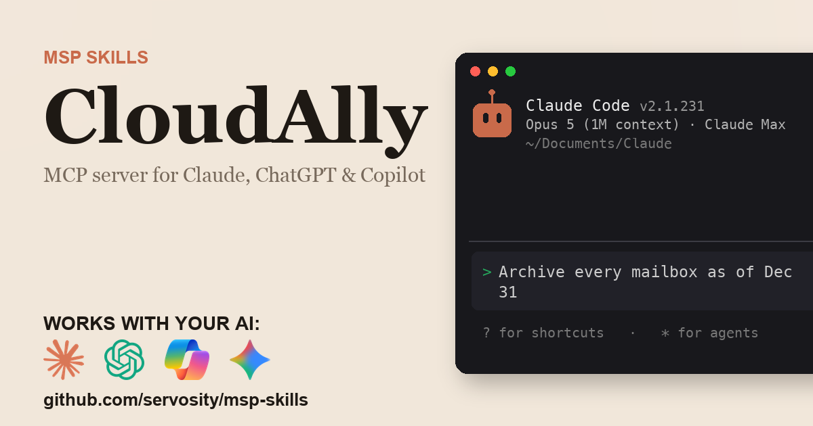

# CloudAlly + AI - for ChatGPT, Claude, GitHub Copilot, Microsoft 365 Copilot, Gemini, and any agent that speaks MCP

> Unofficial. Community-built Claude Code Skill and MCP server for the CloudAlly
> API. Not affiliated with, endorsed by, or sponsored by CloudAlly or OpenText.
> CloudAlly is a trademark of OpenText Corporation.

<!-- media:start -->
<p align="center">
  <a href="https://msp-skills.compoundingteams.com/skills/cloudally/">
    
  </a>
</p>
<!-- media:end -->

Restore or download every CloudAlly mailbox as it stood on a past date, read each mailbox's backup history, and find failing backups across every customer. Works with the AI you already use - **ChatGPT** (Plus/Pro+), **Claude Desktop**, **Codex**, **Claude Code**, **Claude Cowork**, and **GitHub Copilot** - plus **Microsoft 365 Copilot / Copilot Studio** and **Google Gemini** via the remote path. Free, open source, runs on your laptop. Built for MSP owners. No code required.

## Works with your agent

The six agents MSP owners actually use (self-serve, works today):

| Your AI agent | How to install the CloudAlly skill |
| --- | --- |
| **Claude Desktop** | Run installer, then **Settings > Extensions** to register `cloudally-mcp` (no JSON editing). |
| **ChatGPT** (paid plans) | Run installer, serve `cloudally-mcp` over HTTPS behind an OAuth proxy that adds its bearer token, register as a Developer Mode connector. |
| **Codex CLI** | Paste the install prompt below. |
| **Claude Code** | Paste the install prompt below. |
| **Claude Cowork** | Paste the install prompt below. |
| **GitHub Copilot** (VS Code) | Run installer, add `cloudally-mcp` to `mcp.json` under the `servers` key, then pick **Agent** mode. |

For ChatGPT, run `cloudally-mcp --transport http` and serve it over HTTPS behind an authenticating proxy that signs ChatGPT in with OAuth and adds the `Authorization: Bearer` header the server requires (ChatGPT cannot send a fixed bearer token, so a bare tunnel gets HTTP 401) - no bridge package is needed. See [mcp-install.md](./mcp-install.md).

### Also for the Microsoft and Google stacks

Big install base, but an honest heads-up: these are the **remote / enterprise** path, not the local binary you just installed.

| Agent | What it takes |
| --- | --- |
| **Microsoft 365 Copilot / Copilot Studio** | **Not self-serve.** Host `cloudally-mcp` over HTTPS, then wire it into Copilot Studio (**Tools > Add a tool > Model Context Protocol > Server URL**) or a declarative agent. Needs a Copilot Studio license + tenant admin. See [mcp-install.md](./mcp-install.md). |
| **Google Gemini** | **Gemini CLI** is local - same as Claude Code. The **Gemini app** is remote - same HTTPS path as ChatGPT, authenticating proxy included. See [mcp-install.md](./mcp-install.md). |

> **Skill-native agents (also covered):** [Hermes](https://hermes-agent.nousresearch.com) and [OpenClaw](#install-for-openclaw) read this skill's `SKILL.md` directly *and* speak MCP - see their install sections below. Also works with Cursor, Windsurf, Cline, Continue.dev, and Zed via MCP. Full per-tool wire-up: **[docs/which-agent.md](../../docs/which-agent.md)**.

> **Run more than one agent?** Install across all 51+ supported agents in one command: `npx skills add Servosity/msp-skills@latest` (requires Node.js, then run the per-skill installer for the CLI/MCP binaries). See [docs/which-agent.md](../../docs/which-agent.md#install-across-all-your-agents-at-once).

## Install in 60 seconds

### Fastest for Claude Desktop - one-click `.mcpb`

[**Download CloudAlly MCP (.mcpb)**](https://github.com/servosity/msp-skills/releases/download/cloudally-v0.1.0/cloudally-mcp.mcpb) - then open **Claude Desktop > Settings > Extensions** and select the file. One click, no JSON, no shell. (Browse every CloudAlly release on the [releases page](https://github.com/servosity/msp-skills/releases?q=cloudally).)

CloudAlly still needs one sign-in from a terminal: the extension calls `cloudally-cli` for its tools and reads its saved token, so also install the CLI (Path B below) and run `cloudally-cli auth login --partner` (or `auth login` for one company) once.

Prefer the Claude Code plugin? Add the marketplace once, then install - works immediately, no directory listing required:

```
/plugin marketplace add Servosity/msp-skills
/plugin install cloudally@msp-skills
```

### Path A - paste one prompt into your AI agent (recommended)

Copy this into **Claude Code**, **Codex CLI**, or **Claude Cowork**:

> Install the CloudAlly Skill and MCP server from Servosity/msp-skills in this agent workspace. If this workspace uses a POSIX shell (macOS, Linux, WSL, or Bash), run `bash <(curl -fsSL https://raw.githubusercontent.com/Servosity/msp-skills/main/skills/cloudally/install.sh)`. If it uses Windows PowerShell, run `iwr -useb https://raw.githubusercontent.com/Servosity/msp-skills/main/skills/cloudally/install.ps1 | iex`. Then authenticate per the README and run `cloudally-cli --help` to explore.

The same prompt works in any agent that can run shell.

### Path B - run the installer yourself

**Windows (PowerShell):**

```powershell
iwr -useb https://raw.githubusercontent.com/Servosity/msp-skills/main/skills/cloudally/install.ps1 | iex
```

**macOS / Linux:**

```bash
bash <(curl -fsSL https://raw.githubusercontent.com/Servosity/msp-skills/main/skills/cloudally/install.sh)
```

The installer drops both `cloudally-cli` (the CLI) and `cloudally-mcp` (the MCP server) into your user bin path. Claude Code, Codex, and Cowork discover the Skill via `SKILL.md` in this directory.

Verify:

```bash
cloudally-cli --version
```

### Upgrade to the latest version

The installer always fetches the current release - re-run it to upgrade:

**macOS / Linux:**

```bash
bash <(curl -fsSL https://raw.githubusercontent.com/Servosity/msp-skills/main/skills/cloudally/install.sh)
```

**Windows (PowerShell):**

```powershell
iwr -useb https://raw.githubusercontent.com/Servosity/msp-skills/main/skills/cloudally/install.ps1 | iex
```

Claude Desktop `.mcpb` users: download the latest `.mcpb` (top of this section) and re-select it in **Settings > Extensions**. Claude Code plugin users: `/plugin update cloudally@msp-skills`.

### Add to Claude Desktop, GitHub Copilot, Gemini CLI, Microsoft 365 Copilot, or another MCP client

After the installer runs, see **[mcp-install.md](./mcp-install.md)** and **[docs/which-agent.md](../../docs/which-agent.md)** for the per-agent wire-up - one section per agent, including the GitHub Copilot `servers` key and the remote Microsoft 365 Copilot / Copilot Studio path. Claude Desktop's Settings > Extensions panel is the simplest path; the MCP config block (for users who prefer editing JSON) is documented in mcp-install.md.

<!-- pp-hermes-install-anchor -->
### Install for Hermes

From the Hermes CLI:

```bash
hermes skills install servosity/msp-skills/skills/cloudally --force
```

Inside a Hermes chat session:

```
/skills install servosity/msp-skills/skills/cloudally --force
```

Hermes [speaks MCP natively](https://hermes-agent.nousresearch.com), so it can also use the `cloudally-mcp` server directly - same install path, same env vars.

### Install for OpenClaw

Tell your OpenClaw agent (copy this):

> Install the cloudally skill from https://github.com/servosity/msp-skills/tree/main/skills/cloudally. The skill defines how its required CLI (`cloudally-cli`) can be installed via the `openclaw:` frontmatter block.

OpenClaw isn't generally available yet; the frontmatter wiring is pre-shipped and will activate the moment OpenClaw launches.

### Authenticate

Create an API application in the CloudAlly partner portal (**Integrations > REST API**), then sign in once with your partner login and check it:

```bash
export CLOUDALLY_CLIENT_ID=<client id>
export CLOUDALLY_CLIENT_SECRET=<client secret>
export CLOUDALLY_PARTNER_EMAIL=<partner portal login email>
cloudally-cli auth login --partner --password-stdin < password-file
cloudally-cli doctor
```

Windows (PowerShell):

```powershell
$env:CLOUDALLY_CLIENT_ID = "<client id>"
$env:CLOUDALLY_CLIENT_SECRET = "<client secret>"
$env:CLOUDALLY_PARTNER_EMAIL = "<partner portal login email>"
Get-Content password-file | cloudally-cli auth login --partner --password-stdin
cloudally-cli doctor
```

`$env:` lasts only for that window; use `setx` or System Properties > Environment Variables to keep the key pair.

`auth login --partner` saves the access and refresh tokens (never printed) and the CLI refreshes them on its own. The partner login reaches every customer and is what past backup dates, downloads and `backup health` need. To work inside one company only, set `CLOUDALLY_EMAIL` and `CLOUDALLY_PASSWORD` and run `cloudally-cli auth login` instead. `doctor` then makes one authenticated read (`GET /v2/user`), so it reports whether the token actually works, not just whether one is set.


## What this skill does

| Question your MSP keeps asking | Command |
| --- | --- |
| Which mailboxes across all my customers have not backed up in two days, or failed? | `cloudally-cli backup health --stale-days 2 --group-by account` |
| What backups does this mailbox have for December? | `cloudally-cli backup snapshots --account 5f1c2a --task 64b0e9 --entity jane.doe@contoso.com --month 2025-12` |
| Which backup would each mailbox be restored from for December 31st? | `cloudally-cli restore plan --account 5f1c2a --task 64b0e9 --date 2025-12-31` |
| Restore every mailbox on the task to October 1st | `cloudally-cli restore plan --account 5f1c2a --task 64b0e9 --date 2026-10-01`, then the same flags on `restore submit` plus `--yes` once the human confirms the plan |
| Archive every mailbox as it stood on December 31st, in the customer's timezone | `cloudally-cli download submit --account 5f1c2a --task 64b0e9 --on-date 2025-12-31 --utc-offset -5 --yes` |
| Download every finished archive to disk | `cloudally-cli download fetch --account 5f1c2a --dest ./archives --year 2025 --on-date 2025-12-31` |
| What did we restore for this customer since September? | `cloudally-cli restore history --account 5f1c2a --since 2026-09-01` |

Full command reference: [guide.md](./guide.md). For the AI-agent operating contract (`--agent`, `--dry-run`, when to confirm before mutating, and how CloudAlly behaves), see [AGENTS.md](./AGENTS.md).

## What makes this different

[cloudally](https://github.com/jancotanis/cloudally) (a Ruby gem) and [n8n-nodes-cloudally](https://github.com/davejlong/n8n-nodes-cloudally) (n8n workflow nodes) wrap CloudAlly's documented API.

This one is a single binary that works as a CLI and an MCP server, and it goes past the documented API where that API stops. CloudAlly's API reports only each mailbox's latest backup and its export call creates no job, so `backup snapshots`, `restore plan` and the download commands read past backup dates and create downloads through the customer portal, using the same partner handoff the partner portal uses when you click a customer. `restore submit` works on a whole task and one or more dates, `download submit` on a whole task and one date, record every row in a local ledger, and resume without resending anything whose outcome is unknown. `download fetch` mints each 60-second download link and streams the archive in the same step.

CloudAlly's own partner and customer portals restore and export one mailbox and one date at a time through a wizard. This works from the AI agent you already use, shows a plan before anything changes, and keeps a local record of every restore and download it started.

## The pain this closes

"Restore every mailbox to how it was on the 1st" and "give us every mailbox as it stood on December 31st for the last few years" are routine requests, and in the CloudAlly portal each one is a wizard per mailbox per date. The documented API cannot answer which backup existed on a past date, an MS365 mailbox is five separate downloads with their own timestamps, timestamps are UTC (so the backup stamped December 31st holds December 30th for a US customer), and download links die after 60 seconds.

- `cloudally-cli restore plan` then `restore submit` - a whole task restored to one date, planned first and recorded in a ledger.
- `cloudally-cli download submit --utc-offset -5` then `download fetch` - year-end archives of every mailbox, in the customer's own day, collected to disk.
- `cloudally-cli backup health` - every stale or failing mailbox across every customer in one list.

See [pain-point.md](./pain-point.md) for the longer narrative.

## Frequently asked questions

### Does this work with ChatGPT?

Yes, on **Plus, Pro, Team, Business, Enterprise, and Education** plans (Free tier does not yet expose Developer Mode). ChatGPT connects to **remote** MCP servers over HTTPS, not local stdio binaries. The CloudAlly MCP server runs locally, but it speaks HTTP natively: set `CLOUDALLY_MCP_HTTP_TOKEN` to a long random value, start it with `cloudally-mcp --transport http` (it serves `http://127.0.0.1:7777/mcp` by default and refuses to start without that token), and serve that endpoint over HTTPS behind an authenticating proxy that signs ChatGPT in with OAuth and adds the `Authorization: Bearer` header the server requires (ChatGPT cannot send a fixed bearer token, so a bare tunnel gets HTTP 401). No bridge package is involved. Step-by-step in [mcp-install.md](./mcp-install.md).

### Does this work with Codex, Cursor, Windsurf, Cline, Copilot, or Gemini?

Yes - all of them speak MCP. Cross-tool install commands are in the matrix above and the deep-dive in [docs/which-agent.md](../../docs/which-agent.md).

### Do I need to know how to code?

No. The recommended install is to paste one sentence into Claude Code or Codex - your agent reads `SKILL.md` and does the install. The fallback is a one-line installer per OS (bash or PowerShell). Neither path requires writing code. You'll enter the CloudAlly API client id and secret once and run `cloudally-cli auth login --partner`.

### Is my CloudAlly data safe?

Your data stays on **your machine**. The CLI and MCP server are local binaries. The SQLite mirror sits in a directory under your user account. The AI agent only sees what the CLI returns - typically a query result, not raw bulk data. Download links are minted and streamed in one step, never stored. Credentials are read from your environment or your agent's config; never bundled into this repo or transmitted anywhere by MSP Skills.

### What credentials does it need?

A CloudAlly API application key pair (`CLOUDALLY_CLIENT_ID`, `CLOUDALLY_CLIENT_SECRET`) plus one login. `auth login --partner` (with `CLOUDALLY_PARTNER_EMAIL` and `CLOUDALLY_PARTNER_PASSWORD`) reaches every customer and is needed for past backup dates and downloads; `auth login` (with `CLOUDALLY_EMAIL` and `CLOUDALLY_PASSWORD`) is limited to one company.

### Can it change or delete my customers' backups?

It can, because CloudAlly's API can: restores write back into live mailboxes, and deleting a backup task deletes its backed-up data. `restore submit`, `download submit` and `download start` print exactly what they would do and stop until you pass `--yes`, and download jobs are only ever EXPORT jobs. The generated API commands (`recovery restore` and every delete or unsubscribe) send at once with no confirmation, so [governance.md](./governance.md) marks them human-only. `CLOUDALLY_MCP_READ_ONLY=1` gives an MCP agent read-only tools. With it off (the default), `restore_submit`, `download_submit` and `download_start` only preview, but `cloudally_execute` can call any API endpoint at once, including `recovery restore` and `tasks delete`, with no plan, ledger, guard or confirmation, and `download_link` returns live 60-second links; set it to 1 unless a human approves every call.

### Why does a December 31st download hold December 30th?

CloudAlly stamps backups in UTC, and a nightly backup runs late in the evening local time, so it is stamped the next UTC day. Pass `--utc-offset` to `download submit` (`-5` for US Eastern) and `--on-date` then means the customer's own calendar day.

### What does it cost?

Free. Apache-2.0 licensed. You pay only for whichever AI agent you use (Claude, ChatGPT, Codex, etc.), and that's billed by your AI provider, not by us.

## Safety model

| Tier | Examples | Recommended agent policy |
| --- | --- | --- |
| Read | `backup health`, `backup snapshots`, `restore plan`, `restore watch`, `restore history`, `download list`, `download watch`; every list / get / details / bills / backup-statuses read; `sync`, `search`, `export` (local writes only: the response cache, the local store, files you name) | Allow |
| Sensitive read | `download link` (a 60-second presigned URL to a mailbox archive), `download fetch` (writes complete mailbox archives to disk) | Human-in-the-loop; never paste a link anywhere |
| Write | `download submit`, `download start` (EXPORT jobs only); `backup-now`, `activate`, `pause`, `add-entity`, `cancel` on backup tasks; creating accounts, resellers and users (`import` included); settings and permission updates | Human-in-the-loop |
| Restore | `restore submit` and the `recovery restore` commands (write back into live mailboxes, sites and drives) | Human-in-the-loop; run `restore plan` first |
| Destructive | `tasks delete` and its distributor and reseller variants (delete a backup task and its data), `remove-entity`, `unsubscribe`, `user delete`, `delete-user` | Human only |
| Credential | `auth login`, `auth use-account`, `auth set-token`, `auth logout`, `session login`, `session partner-login` and `session refresh`, `access-token`, `sign-in-token`, `user update-password` | Human-in-the-loop only |
| Data egress | `--deliver webhook:<url>`, `feedback --send`, and `feedback` when `CLOUDALLY_FEEDBACK_ENDPOINT` is set with `CLOUDALLY_FEEDBACK_AUTO_SEND=true` | Human-in-the-loop |

The MCP `cloudally_execute` tool can call any endpoint of CloudAlly's spec by ID: each call follows the tiers above, and every non-GET call is refused while `CLOUDALLY_MCP_READ_ONLY=1`.

The strongest control is the **company login** (`auth login`), which cannot reach any other customer; use the partner login only where partner-wide work is needed. Full details, including how to lock it down, are in [governance.md](./governance.md).

## Status

Beta, awaiting live verification. Servosity built this connector for its own CloudAlly partner tenant and has run it there in production: backup calendar reads across customers and a multi-terabyte year-end mailbox export. That first-party run is not yet recorded as a badge, and a report from an MSP outside this project is still the most valuable receipt. The command surface is CloudAlly's published Management API v2 plus the customer-portal calls described in [guide.md](./guide.md), covered by unit and integration tests against simulated CloudAlly and portal responses. If you run it against your own tenant, the it-works form is how that becomes a badge. MSPs put connectors like this through their paces in our weekly Build Sessions - RSVP at [compoundingteams.com/build-sessions](https://compoundingteams.com/build-sessions).

---

**Standards.** Conforms to the open [Agent Skills spec](https://agentskills.io) (Anthropic, Dec 2025; 40+ agents). MCP-compatible - works with any MCP-capable agent including [Hermes](https://hermes-agent.nousresearch.com). OpenClaw-ready (frontmatter pre-wired, awaiting OpenClaw launch).

Maintained by [Servosity](https://www.servosity.com). Apache-2.0 licensed. Built with [CLI Printing Press](https://github.com/mvanhorn/cli-printing-press). _Last updated: 2026-10-19._
