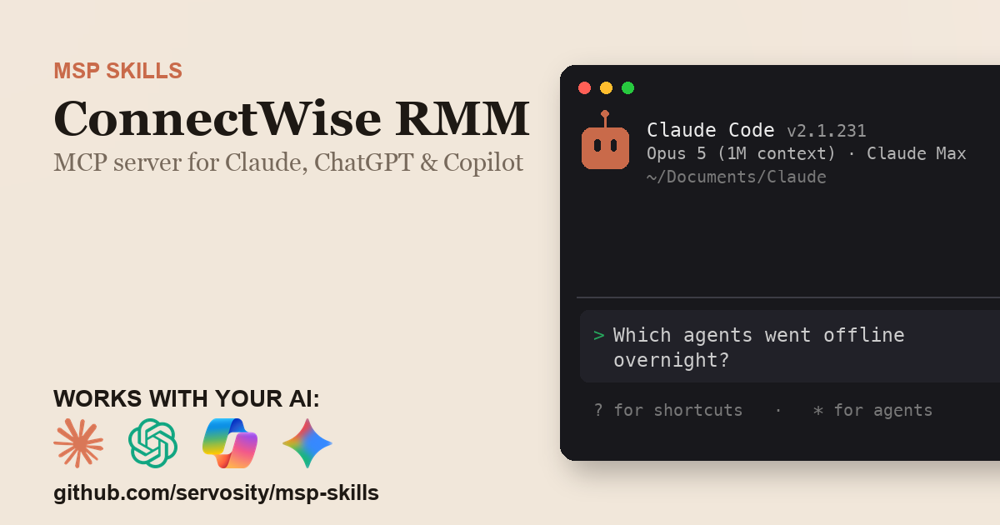

# ConnectWise RMM + AI - for ChatGPT, Claude, GitHub Copilot, Microsoft 365 Copilot, Gemini, and any agent that speaks MCP

> Unofficial. Community-built Claude Code Skill and MCP server for the ConnectWise RMM
> (Asio) partner API. Not affiliated with, endorsed by, or sponsored by ConnectWise, LLC.

<!-- media:start -->
<p align="center">
  <a href="https://msp-skills.compoundingteams.com/skills/connectwise-rmm/">
    
  </a>
</p>
<p align="center"><sub><a href="https://msp-skills.compoundingteams.com/skills/connectwise-rmm/">Full skill page</a> - install, outcomes, safety model.</sub></p>
<!-- media:end -->

66 ConnectWise RMM (Asio) partner API operations, plus a local fleet database, patch-compliance rollups, and script runs you can preview, schedule and watch in one command. Works with the AI you already use - **ChatGPT** (Plus/Pro+), **Claude Desktop**, **Codex**, **Claude Code**, **Claude Cowork**, and **GitHub Copilot** - plus **Microsoft 365 Copilot / Copilot Studio** and **Google Gemini** via the remote path. Free, open source, runs on your laptop. Built for MSP owners. No code required.

## Works with your agent

The six agents MSP owners actually use (self-serve, works today):

| Your AI agent | How to install the ConnectWise RMM skill |
| --- | --- |
| **Claude Desktop** | Run installer, then **Settings > Extensions** to register `connectwise-rmm-mcp` (no JSON editing). |
| **ChatGPT** (paid plans) | Run installer, expose `connectwise-rmm-mcp` over HTTPS, register as a Developer Mode connector. |
| **Codex CLI** | Paste the install prompt below. |
| **Claude Code** | Paste the install prompt below. |
| **Claude Cowork** | Paste the install prompt below. |
| **GitHub Copilot** (VS Code) | Run installer, add `connectwise-rmm-mcp` to `mcp.json` under the `servers` key, then pick **Agent** mode. |

For ChatGPT, run `connectwise-rmm-mcp --transport http` and expose that behind HTTPS - no bridge package is needed. See [mcp-install.md](./mcp-install.md).

### Also for the Microsoft and Google stacks

Big install base, but an honest heads-up: these are the **remote / enterprise** path, not the local binary you just installed.

| Agent | What it takes |
| --- | --- |
| **Microsoft 365 Copilot / Copilot Studio** | **Not self-serve.** Host `connectwise-rmm-mcp` over HTTPS, then wire it into Copilot Studio (**Tools > Add a tool > Model Context Protocol > Server URL**) or a declarative agent. Needs a Copilot Studio license + tenant admin. See [mcp-install.md](./mcp-install.md). |
| **Google Gemini** | **Gemini CLI** is local - same as Claude Code. The **Gemini app** is remote - same HTTPS path as ChatGPT. See [mcp-install.md](./mcp-install.md). |

> **Skill-native agents (also covered):** [Hermes](https://hermes-agent.nousresearch.com) and [OpenClaw](#install-for-openclaw) read this skill's `SKILL.md` directly *and* speak MCP - see their install sections below. Also works with Cursor, Windsurf, Cline, Continue.dev, and Zed via MCP. Full per-tool wire-up: **[docs/which-agent.md](../../docs/which-agent.md)**.

> **Run more than one agent?** Install across all 51+ supported agents in one command: `npx skills add Servosity/msp-skills@latest` (requires Node.js, then run the per-skill installer for the CLI/MCP binaries). See [docs/which-agent.md](../../docs/which-agent.md#install-across-all-your-agents-at-once).

## Install in 60 seconds

### Fastest for Claude Desktop - one-click `.mcpb`

[**Download ConnectWise RMM MCP (.mcpb)**](https://github.com/servosity/msp-skills/releases/download/connectwise-rmm-v0.1.0/connectwise-rmm-mcp.mcpb) - then open **Claude Desktop > Settings > Extensions** and select the file. One click, no JSON, no shell. (Browse every ConnectWise RMM release on the [releases page](https://github.com/servosity/msp-skills/releases?q=connectwise-rmm).)

Prefer the Claude Code plugin? Add the marketplace once, then install - works immediately, no directory listing required:

```
/plugin marketplace add Servosity/msp-skills
/plugin install connectwise-rmm@msp-skills
```

### Path A - paste one prompt into your AI agent (recommended)

Copy this into **Claude Code**, **Codex CLI**, or **Claude Cowork**:

> Install the ConnectWise RMM Skill and MCP server from Servosity/msp-skills in this agent workspace. If this workspace uses a POSIX shell (macOS, Linux, WSL, or Bash), run `bash <(curl -fsSL https://raw.githubusercontent.com/Servosity/msp-skills/main/skills/connectwise-rmm/install.sh)`. If it uses Windows PowerShell, run `iwr -useb https://raw.githubusercontent.com/Servosity/msp-skills/main/skills/connectwise-rmm/install.ps1 | iex`. Then authenticate per the README and run `connectwise-rmm-cli --help` to explore.

The same prompt works in any agent that can run shell.

### Path B - run the installer yourself

**Windows (PowerShell):**

```powershell
iwr -useb https://raw.githubusercontent.com/Servosity/msp-skills/main/skills/connectwise-rmm/install.ps1 | iex
```

**macOS / Linux:**

```bash
bash <(curl -fsSL https://raw.githubusercontent.com/Servosity/msp-skills/main/skills/connectwise-rmm/install.sh)
```

The installer drops both `connectwise-rmm-cli` (the CLI) and `connectwise-rmm-mcp` (the MCP server) into your user bin path. Claude Code, Codex, and Cowork discover the Skill via `SKILL.md` in this directory.

Verify:

```bash
connectwise-rmm-cli --version
```

### Upgrade to the latest version

The installer always fetches the current release - re-run it to upgrade:

**macOS / Linux:**

```bash
bash <(curl -fsSL https://raw.githubusercontent.com/Servosity/msp-skills/main/skills/connectwise-rmm/install.sh)
```

**Windows (PowerShell):**

```powershell
iwr -useb https://raw.githubusercontent.com/Servosity/msp-skills/main/skills/connectwise-rmm/install.ps1 | iex
```

Claude Desktop `.mcpb` users: download the latest `.mcpb` (top of this section) and re-select it in **Settings > Extensions**. Claude Code plugin users: `/plugin update connectwise-rmm@msp-skills`.

### Add to Claude Desktop, GitHub Copilot, Gemini CLI, Microsoft 365 Copilot, or another MCP client

After the installer runs, see **[mcp-install.md](./mcp-install.md)** and **[docs/which-agent.md](../../docs/which-agent.md)** for the per-agent wire-up - one section per agent, including the GitHub Copilot `servers` key and the remote Microsoft 365 Copilot / Copilot Studio path. Claude Desktop's Settings > Extensions panel is the simplest path; the MCP config block (for users who prefer editing JSON) is documented in mcp-install.md.

<!-- pp-hermes-install-anchor -->
### Install for Hermes

From the Hermes CLI:

```bash
hermes skills install servosity/msp-skills/skills/connectwise-rmm --force
```

Inside a Hermes chat session:

```
/skills install servosity/msp-skills/skills/connectwise-rmm --force
```

Hermes [speaks MCP natively](https://hermes-agent.nousresearch.com), so it can also use the `connectwise-rmm-mcp` server directly - same install path, same env vars.

### Install for OpenClaw

Tell your OpenClaw agent (copy this):

> Install the connectwise-rmm skill from https://github.com/servosity/msp-skills/tree/main/skills/connectwise-rmm. The skill defines how its required CLI (`connectwise-rmm-cli`) can be installed via the `openclaw:` frontmatter block.

OpenClaw isn't generally available yet; the frontmatter wiring is pre-shipped and will activate the moment OpenClaw launches.

### Authenticate

Create an API client under **Integrations > API Access** in the ConnectWise portal, then set its ID and secret:

```bash
CONNECTWISE_RMM_CLIENT_ID=<value> CONNECTWISE_RMM_CLIENT_SECRET=<value> connectwise-rmm-cli doctor
```

A client ID starting 0e30, 0e31 or 0e32 picks North America, Europe or Australia for you; if yours starts differently, set `CONNECTWISE_RMM_BASE_URL` to your region's API host. If your key was not granted every scope this connector uses, run `connectwise-rmm-cli scopes --agent` and set the `CONNECTWISE_RMM_OAUTH_SCOPE` line it prints - ConnectWise rejects a whole token request that asks for one scope the key lacks. Then pull the fleet into the local mirror:

```bash
connectwise-rmm-cli sync --resources companies,sites,endpoints,tickets
```

`doctor` mints a token from your client ID and secret and verifies it against the API, so a wrong secret, a missing scope or a wrong host shows up as a failed Credentials line. It exits 0 even when a check fails, so scripts should add `--fail-on error`.


## What this skill does

| Question your MSP keeps asking | Command |
| --- | --- |
| Which endpoints are offline or silent for more than a day, by client? | `connectwise-rmm-cli fleet stale --older-than 24h --agent` |
| Which clients are behind on patches, worst first? | `connectwise-rmm-cli fleet patch-posture --min-compliance 90 --agent` |
| Which machines need a reboot this patch week, and who is logged on? | `connectwise-rmm-cli fleet reboot-due --agent` |
| Which machine is this user logged on to? | `connectwise-rmm-cli fleet whois "jsmith" --agent` |
| Give me one client's health card for the review. | `connectwise-rmm-cli fleet scorecard "Acme Corp" --agent` |
| Why did last night's script fail, and on which machines? | `connectwise-rmm-cli fleet task-failures "<task-id>" --agent` |
| Run a script on endpoints - preview first, then schedule with `--confirm`. | `connectwise-rmm-cli run --script "Restart Print Spooler" --endpoint "<endpoint-id>"` |
| Which OAuth scopes did my API key actually get? | `connectwise-rmm-cli scopes --agent` |

Full command reference: [guide.md](./guide.md). For the AI-agent operating contract (`--agent`, `--dry-run`, when to confirm before mutating), see [AGENTS.md](./AGENTS.md).

## What makes this different

Most ConnectWise RMM integrations and MCP servers - the open-source [connectwise-asio-mcp](https://github.com/MSPbotsAI/connectwise-asio-mcp) and [asio-cli](https://github.com/tfournet/asio-cli) among them - work against the live API with no persistent local copy. That's fine for one device. It dies at scale, when you're asking "which agents are offline across all 40 clients" or "who's behind on patches before this morning's client review", because Asio returns per-endpoint rows keyed by IDs, never a per-client roll-up, and caps availability checks at 400 endpoints per call.

This skill syncs ConnectWise RMM into a **local SQLite mirror** with full-text search, batches the live availability checks, and caches patch summaries. Aggregate questions become one local join, and the AI sees the answer, not the raw data. Compound commands like `fleet patch-posture`, `fleet scorecard`, and `fleet task-failures` join companies, sites, endpoints, patch summaries, tickets and task results - work a stateless API wrapper can't do.

## The pain this closes

ConnectWise RMM (the cloud RMM on the ConnectWise Asio platform, formerly Command and Continuum) is built around a per-client, per-device view, and its partner API is the same shape: ConnectWise's own documentation caps availability checks at 400 endpoints per call and 40 calls per 5 minutes, and patch compliance comes back as per-endpoint rows keyed by IDs, with no per-client roll-up. On r/msp the recurring RMM complaint is the same across vendors - no clean cross-client roll-up - so owners export device lists into spreadsheets before a client review and find dead agents when the customer calls. Script pushes have the reverse problem: every endpoint's result carries its own raw error text, and grouping the identical failures is manual.

This skill answers those questions directly:

- `fleet stale --older-than 24h` - every offline or silent agent across all clients, grouped by company
- `fleet patch-posture --min-compliance 90` - clients ranked by patch risk, ready for the review
- `fleet reboot-due` - the patch-week reboot queue: reboot now, coordinate with a logged-on user, offline
- `fleet whois "jsmith"` - which machine a caller is logged on to
- `fleet task-failures "<task-id>"` - failed endpoints grouped by identical error, with IDs ready to re-run

See [pain-point.md](./pain-point.md) for the longer narrative.

## Frequently asked questions

### Does this work with ChatGPT?

Yes, on **Plus, Pro, Team, Business, Enterprise, and Education** plans (Free tier does not yet expose Developer Mode). ChatGPT connects to **remote** MCP servers over HTTPS, not local stdio binaries. The ConnectWise RMM MCP server runs locally, but it speaks HTTP natively: set `CONNECTWISE_RMM_MCP_HTTP_TOKEN` to a long random value, start it with `connectwise-rmm-mcp --transport http` (it serves http://127.0.0.1:7777/mcp by default and refuses to start without that token), and put its /mcp endpoint behind an HTTPS tunnel or your own reverse proxy. No bridge package is involved. Step-by-step in [mcp-install.md](./mcp-install.md).

### Does this work with Codex, Cursor, Windsurf, Cline, Copilot, or Gemini?

Yes - all of them speak MCP. Cross-tool install commands are in the matrix above and the deep-dive in [docs/which-agent.md](../../docs/which-agent.md).

### Do I need to know how to code?

No. The recommended install is to paste one sentence into Claude Code or Codex - your agent reads `SKILL.md` and does the install. The fallback is a one-line installer per OS (bash or PowerShell). Neither path requires writing code. You'll enter your ConnectWise RMM API key once.

### Is my ConnectWise RMM data safe?

Your data stays on **your machine**. The CLI and MCP server are local binaries. The SQLite mirror sits in a directory under your user account. The AI agent only sees what the CLI returns - typically a query result, not raw bulk data. Credentials are read from your environment or your agent's config; never bundled into this repo or transmitted anywhere by MSP Skills.

### Is this for ConnectWise RMM, ConnectWise Automate, or ConnectWise PSA?

ConnectWise RMM - the cloud RMM on the ConnectWise Asio platform (formerly Command and Continuum). ConnectWise Automate (LabTech), ConnectWise PSA (Manage) and ConnectWise ScreenConnect (Control) each have their own skill. This one talks to the Asio partner API for companies, sites, endpoints, patching, scripts and tasks, and Asio's own service tickets.

### Will this hit my ConnectWise RMM API rate limits?

The local mirror is the point. You `sync` companies, sites, endpoints and tickets, and roll-ups run against that copy. Availability is checked 400 endpoints per call, patch summaries are cached for 12 hours by default, and the CLI slows down automatically when Asio answers HTTP 429.

### Can my AI run scripts on client machines?

Only through commands you allow. From the CLI, `run` previews by default: it resolves the script and the target machines, prints the exact request, and schedules nothing until you add `--confirm`. Three other paths schedule immediately: `tasks schedule`, `import` of task records, and the MCP server's generic `connectwise-rmm_execute` tool. For an agent that must never run scripts, set `CONNECTWISE_RMM_MCP_READ_ONLY=1` (the MCP server then drops its write tools and refuses every non-read API call) and do not grant the key the `platform.automation.create` scope. A cached API client wins over the environment variables, so after switching to a narrower key run `connectwise-rmm-cli auth logout` first.

### Will this replace the ConnectWise RMM portal?

No. The portal stays where you configure policies, monitoring and remote access. This skill answers cross-client reporting and triage questions from your AI agent or terminal, and complements ConnectWise's built-in AI, ConnectWise Sidekick, rather than replacing it.

### What does it cost?

Free. Apache-2.0 licensed. You pay only for whichever AI agent you use (Claude, ChatGPT, Codex, etc.), and that's billed by your AI provider, not by us.

## Safety model

| Tier | Examples | Recommended agent policy |
| --- | --- | --- |
| Read | `fleet stale`, `fleet patch-posture`, `fleet reboot-due`, `fleet whois`, `fleet brief`, `fleet scorecard`, `fleet task-failures`, `scopes`, `sync`, `search`, `run` without `--confirm` (preview), all `list`/`get` | Allow |
| Endpoint actions | `run --confirm`, `tasks schedule` (alias `tasks create`), `import` of task records, and the MCP `connectwise-rmm_execute` tool calling `tasks.schedule` - each runs a script on real endpoints | Human-in-the-loop, explicit confirmation |
| Destructive | `endpoints uninstall` (alias `endpoints delete`; removes the agent, the endpoint stops being managed) | Human-in-the-loop only, explicit confirmation |
| Write (records) | `tickets create` / `update`, `ticket-notes create`, `sites create` / `update`, `custom-fields set-company` / `set-site` / `set-endpoint`, `import` of ticket records | Preview with `--dry-run`, then a reviewed write |
| Credential | `endpoints create-agent-install-token` (alias `endpoints create`), `import` of endpoint records (mints install tokens), `auth login`, `auth set-token` | Human-in-the-loop only |

To make the MCP server read-only, set `CONNECTWISE_RMM_MCP_READ_ONLY=1`: it drops its write tools and refuses every non-read API call.

The strongest control is the **scopes you grant the ConnectWise RMM API key** - the CLI can only do what the key is permitted to do. Full details, including how to lock it down, are in [governance.md](./governance.md).

## Status

Beta. Built against the ConnectWise RMM partner API (every route confirmed on the live gateway without credentials; behavior tested against a mock gateway) and awaiting validation with MSPs running it live against their own production tenant in our weekly Build Sessions. RSVP at [compoundingteams.com/build-sessions](https://compoundingteams.com/build-sessions).

---

**Standards.** Conforms to the open [Agent Skills spec](https://agentskills.io) (Anthropic, Dec 2025; 40+ agents). MCP-compatible - works with any MCP-capable agent including [Hermes](https://hermes-agent.nousresearch.com). OpenClaw-ready (frontmatter pre-wired, awaiting OpenClaw launch).

Maintained by [Servosity](https://www.servosity.com). Apache-2.0 licensed. Built with [CLI Printing Press](https://github.com/mvanhorn/cli-printing-press). _Last updated: 2026-10-13._
