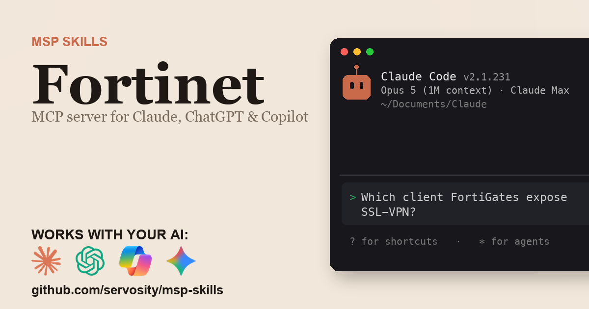

# Fortinet + AI - for ChatGPT, Claude, GitHub Copilot, Microsoft 365 Copilot, Gemini, and any agent that speaks MCP

> Unofficial. Community-built Claude Code Skill and MCP server for the Fortinet
> API. Not affiliated with, endorsed by, or sponsored by Fortinet, Inc.

<!-- media:start -->
<p align="center">
  <a href="https://msp-skills.compoundingteams.com/skills/fortinet/">
    
  </a>
</p>
<p align="center"><sub><a href="https://msp-skills.compoundingteams.com/skills/fortinet/">Full skill page</a> - install, outcomes, safety model.</sub></p>
<!-- media:end -->

Read every FortiGate's configuration and live state, then audit the whole client fleet for firmware, SSL-VPN exposure, admin accounts and license expiry in one command. Works with the AI you already use - **ChatGPT** (Plus/Pro+), **Claude Desktop**, **Codex**, **Claude Code**, **Claude Cowork**, and **GitHub Copilot** - plus **Microsoft 365 Copilot / Copilot Studio** and **Google Gemini** via the remote path. Free, open source, runs on your laptop. Built for MSP owners. No code required.

## Works with your agent

The six agents MSP owners actually use (self-serve, works today):

| Your AI agent | How to install the Fortinet skill |
| --- | --- |
| **Claude Desktop** | Run installer, then **Settings > Extensions** to register `fortinet-mcp` (no JSON editing). |
| **ChatGPT** (paid plans) | Run installer, expose `fortinet-mcp` over HTTPS, register as a Developer Mode connector. |
| **Codex CLI** | Paste the install prompt below. |
| **Claude Code** | Paste the install prompt below. |
| **Claude Cowork** | Paste the install prompt below. |
| **GitHub Copilot** (VS Code) | Run installer, add `fortinet-mcp` to `mcp.json` under the `servers` key, then pick **Agent** mode. |

For ChatGPT, run `fortinet-mcp --transport http` and expose that behind HTTPS - no bridge package is needed. See [mcp-install.md](./mcp-install.md).

### Also for the Microsoft and Google stacks

Big install base, but an honest heads-up: these are the **remote / enterprise** path, not the local binary you just installed.

| Agent | What it takes |
| --- | --- |
| **Microsoft 365 Copilot / Copilot Studio** | **Not self-serve.** Host `fortinet-mcp` over HTTPS, then wire it into Copilot Studio (**Tools > Add a tool > Model Context Protocol > Server URL**) or a declarative agent. Needs a Copilot Studio license + tenant admin. See [mcp-install.md](./mcp-install.md). |
| **Google Gemini** | **Gemini CLI** is local - same as Claude Code. The **Gemini app** is remote - same HTTPS path as ChatGPT. See [mcp-install.md](./mcp-install.md). |

> **Skill-native agents (also covered):** [Hermes](https://hermes-agent.nousresearch.com) and [OpenClaw](#install-for-openclaw) read this skill's `SKILL.md` directly *and* speak MCP - see their install sections below. Also works with Cursor, Windsurf, Cline, Continue.dev, and Zed via MCP. Full per-tool wire-up: **[docs/which-agent.md](../../docs/which-agent.md)**.

> **Run more than one agent?** Install across all 51+ supported agents in one command: `npx skills add Servosity/msp-skills@latest` (requires Node.js, then run the per-skill installer for the CLI/MCP binaries). See [docs/which-agent.md](../../docs/which-agent.md#install-across-all-your-agents-at-once).

## Install in 60 seconds

### Fastest for Claude Desktop - one-click `.mcpb`

[**Download Fortinet MCP (.mcpb)**](https://github.com/servosity/msp-skills/releases/download/fortinet-v0.1.2/fortinet-mcp.mcpb) - then open **Claude Desktop > Settings > Extensions** and select the file. One click, no JSON, no shell. (Browse every Fortinet release on the [releases page](https://github.com/servosity/msp-skills/releases?q=fortinet).)

Prefer the Claude Code plugin? Add the marketplace once, then install - works immediately, no directory listing required:

```
/plugin marketplace add Servosity/msp-skills
/plugin install fortinet@msp-skills
```

### Path A - paste one prompt into your AI agent (recommended)

Copy this into **Claude Code**, **Codex CLI**, or **Claude Cowork**:

> Install the Fortinet Skill and MCP server from Servosity/msp-skills in this agent workspace. If this workspace uses a POSIX shell (macOS, Linux, WSL, or Bash), run `bash <(curl -fsSL https://raw.githubusercontent.com/Servosity/msp-skills/main/skills/fortinet/install.sh)`. If it uses Windows PowerShell, run `iwr -useb https://raw.githubusercontent.com/Servosity/msp-skills/main/skills/fortinet/install.ps1 | iex`. Then authenticate per the README and run `fortinet-cli --help` to explore.

The same prompt works in any agent that can run shell.

### Path B - run the installer yourself

**Windows (PowerShell):**

```powershell
iwr -useb https://raw.githubusercontent.com/Servosity/msp-skills/main/skills/fortinet/install.ps1 | iex
```

**macOS / Linux:**

```bash
bash <(curl -fsSL https://raw.githubusercontent.com/Servosity/msp-skills/main/skills/fortinet/install.sh)
```

The installer drops both `fortinet-cli` (the CLI) and `fortinet-mcp` (the MCP server) into your user bin path. Claude Code, Codex, and Cowork discover the Skill via `SKILL.md` in this directory.

Verify:

```bash
fortinet-cli --version
```

### Upgrade to the latest version

The installer always fetches the current release - re-run it to upgrade:

**macOS / Linux:**

```bash
bash <(curl -fsSL https://raw.githubusercontent.com/Servosity/msp-skills/main/skills/fortinet/install.sh)
```

**Windows (PowerShell):**

```powershell
iwr -useb https://raw.githubusercontent.com/Servosity/msp-skills/main/skills/fortinet/install.ps1 | iex
```

Claude Desktop `.mcpb` users: download the latest `.mcpb` (top of this section) and re-select it in **Settings > Extensions**. Claude Code plugin users: `/plugin update fortinet@msp-skills`.

### Add to Claude Desktop, GitHub Copilot, Gemini CLI, Microsoft 365 Copilot, or another MCP client

After the installer runs, see **[mcp-install.md](./mcp-install.md)** and **[docs/which-agent.md](../../docs/which-agent.md)** for the per-agent wire-up - one section per agent, including the GitHub Copilot `servers` key and the remote Microsoft 365 Copilot / Copilot Studio path. Claude Desktop's Settings > Extensions panel is the simplest path; the MCP config block (for users who prefer editing JSON) is documented in mcp-install.md.

<!-- pp-hermes-install-anchor -->
### Install for Hermes

From the Hermes CLI:

```bash
hermes skills install servosity/msp-skills/skills/fortinet --force
```

Inside a Hermes chat session:

```
/skills install servosity/msp-skills/skills/fortinet --force
```

Hermes [speaks MCP natively](https://hermes-agent.nousresearch.com), so it can also use the `fortinet-mcp` server directly - same install path, same env vars.

### Install for OpenClaw

Tell your OpenClaw agent (copy this):

> Install the fortinet skill from https://github.com/servosity/msp-skills/tree/main/skills/fortinet. The skill defines how its required CLI (`fortinet-cli`) can be installed via the `openclaw:` frontmatter block.

OpenClaw isn't generally available yet; the frontmatter wiring is pre-shipped and will activate the moment OpenClaw launches.

### Authenticate

Create a REST API admin on the FortiGate (System > Administrators > Create New > REST API Admin, read-only profile, your IP as a trusted host), then:

```bash
FORTINET_BASE_URL=<value> FORTINET_API_TOKEN=<value> fortinet-cli doctor
```

`doctor` checks config and paths, then makes one authenticated read (`GET /monitor/system/status`) so it reports whether the token actually works, not just whether one is set. For a fleet of FortiGates, list them in a `devices.toml` file and run `fortinet-cli fleet devices` to see which entries have a usable URL and token file.


## What this skill does

| Question your MSP keeps asking | Command |
| --- | --- |
| One posture verdict across every client FortiGate, only findings new since the last run | `fortinet-cli fleet audit --new` |
| Which FortiGates are below the fixed firmware for their branch? | `fortinet-cli audit firmware --min-version 7.2.10,7.4.5` |
| Where is SSL-VPN on a WAN interface and open to any source? | `fortinet-cli audit sslvpn` |
| Which admins have no trusted hosts or no two-factor? | `fortinet-cli audit admins` |
| Which FortiGuard and FortiCare licenses expire in the next 60 days? | `fortinet-cli audit licenses --within 60d` |
| Which firewalls have HA out of sync, tunnels down, or certificates expiring? | `fortinet-cli fleet health --cert-within 14d` |
| Which policies are any-any accept, unused, or not logging? | `fortinet-cli policies hygiene --unused-days 90` |
| What changed in each client's configuration this week? | `fortinet-cli fleet changes --since 7d` |
| Which FortiManager-managed devices are out of sync? | `fortinet-cli fmg devices` |
| Which FortiGate Cloud devices have the tunnel down or a contract ending? | `fortinet-cli cloud devices` |

Full command reference: [guide.md](./guide.md). For the AI-agent operating contract (`--agent`, `--dry-run`, when to confirm before mutating), see [AGENTS.md](./AGENTS.md).

## What makes this different

[alpadalar/fortigate-mcp-server](https://github.com/alpadalar/fortigate-mcp-server) is a general-purpose FortiGate MCP server: a device registry, read tools, and create, update and delete tools for policies, VIPs and routes that stay off unless you enable writes. It answers about the device you ask about.

This one is read-only by construction and built for the question an MSP asks the morning an SSL-VPN advisory lands: which of my 40 clients are exposed right now? A `devices.toml` file lists every client FortiGate, and `fleet audit` reads all of them in parallel, then grades each one PASS, WARN, FAIL or UNKNOWN for firmware floors per branch, SSL-VPN exposure, admin accounts and license expiry. A box it could not read is UNKNOWN, never PASS. Every run is recorded locally, so `fleet audit --new` shows only findings that are new since the last one, and `fleet backup` plus `fleet changes` show which configuration objects moved between two backups. `fmg` and `cloud` add the FortiManager and FortiGate Cloud inventory alongside, also read-only. Stored secrets stay out of the answers: every FortiOS-encrypted value comes back as `ENC (redacted)`.

Fortinet's FortiAI-Assist runs inside FortiManager and FortiAnalyzer, and since FortiOS 8.0 on FortiGates with more than 2 GB of RAM and FortiCare Premium; it answers inside the console it runs in. This needs only a read-only REST API token per FortiGate, so it also covers the small boxes FortiAI-Assist does not, and it answers across every client's firewall at once.

## The pain this closes

FortiOS SSL-VPN is the part of a client's network that gets attacked first. When Fortinet disclosed CVE-2024-21762 in February 2024 it said the flaw was "potentially being exploited in the wild" ([Rapid7](https://www.rapid7.com/blog/post/2024/02/12/etr-critical-fortinet-fortios-cve-2024-21762-exploited)), and the advice for MSPs was to move every box to the fixed release of its own branch or turn SSL-VPN off ([SmarterMSP](https://smartermsp.com/cybersecurity-threat-advisory-critical-vulnerability-in-fortios/)). Doing that the same morning means knowing which client FortiGates run SSL-VPN, which listen on WAN open to anyone, and which are below the fixed build. FortiOS answers one box at a time; without a FortiManager, that is a login per client.

- `fortinet-cli audit sslvpn` - FAIL for SSL-VPN on a WAN interface open to any source, per device and VDOM.
- `fortinet-cli audit firmware --min-version 7.2.10,7.4.5` - every box below its branch floor, and how far behind.
- `fortinet-cli audit licenses --within 60d` - one renewal queue instead of a spreadsheet.
- `fortinet-cli fleet audit --new --fail-on fail` - all four checks, new findings only, exit 6 for a scheduled job.

See [pain-point.md](./pain-point.md) for the longer narrative.

## Frequently asked questions

### Does this work with ChatGPT?

Yes, on **Plus, Pro, Team, Business, Enterprise, and Education** plans (Free tier does not yet expose Developer Mode). ChatGPT connects to **remote** MCP servers over HTTPS, not local stdio binaries. The Fortinet MCP server runs locally, but it speaks HTTP natively: set `FORTINET_MCP_HTTP_TOKEN` to a long random value, start it with `fortinet-mcp --transport http` (it serves http://127.0.0.1:7777/mcp by default and refuses to start without that token), and put its /mcp endpoint behind an HTTPS tunnel or your own reverse proxy. No bridge package is involved. Step-by-step in [mcp-install.md](./mcp-install.md).

### Does this work with Codex, Cursor, Windsurf, Cline, Copilot, or Gemini?

Yes - all of them speak MCP. Cross-tool install commands are in the matrix above and the deep-dive in [docs/which-agent.md](../../docs/which-agent.md).

### Do I need to know how to code?

No. The recommended install is to paste one sentence into Claude Code or Codex - your agent reads `SKILL.md` and does the install. The fallback is a one-line installer per OS (bash or PowerShell). Neither path requires writing code. You'll enter your Fortinet credentials once.

### Is my Fortinet data safe?

Your data stays on **your machine**. The CLI and MCP server are local binaries. The SQLite mirror sits in a directory under your user account. The AI agent only sees what the CLI returns - typically a query result, not raw bulk data. Credentials are read from your environment or your agent's config; never bundled into this repo or transmitted anywhere by MSP Skills.

### Can it change my FortiGates?

No. Every FortiOS call is a read of configuration tables or monitor state (the `settings` and `monitor` commands read; they do not set), the FortiManager commands send only the JSON-RPC `get` method, and the FortiGate Cloud commands only list devices. Stored secrets stay out of the answers too: every FortiOS-encrypted value (RADIUS secrets, IPsec keys, password hashes) comes back as `ENC (redacted)`, and a request for plain-text passwords is refused. Give each token a REST API admin with a read-only admin profile and the FortiGate itself enforces the rest.

### How do I check 40 client FortiGates, not just one?

List them in `devices.toml`, one `[[device]]` entry each with its `url`, a `token_file` (a file holding that box's token; on macOS and Linux the CLI refuses it unless it is chmod 600) and an optional `client` name. `fortinet-cli fleet devices` shows which entries have a usable URL and token file, and every audit command then runs across the whole list. A devices file you name (with `--devices` or `FORTINET_DEVICES`) that is missing or lists no `[[device]]` entries is an error, never a silent fall-back to one box. Without one, the audits check the single `FORTINET_BASE_URL` device.

### My FortiGate still uses its factory certificate. Will it connect?

Not by default: certificate checks stay on. The secure fix is a trusted certificate on the FortiGate (FortiOS can get one from Let's Encrypt). Otherwise opt in per device with `insecure = true` in `devices.toml`, pass `--insecure`, or add `"FORTINET_SKIP_TLS_VERIFY": "true"` to the MCP server's `env` block in a JSON config (it also turns verification off for FortiManager; `FORTINET_FMG_INSECURE=true` covers FortiManager alone). The one-click `.mcpb` has no field for it on purpose, because one ticked box would turn off verification for every device. A `devices.toml` entry with `insecure = true` covers the fleet, audit and policies hygiene tools there; the single-device tools and the `fmg` tools still need a trusted certificate (or the JSON config above).

### Do I need FortiManager or FortiGate Cloud?

No. Both are optional extras: the `fmg` commands read FortiManager ADOMs and managed devices, and the `cloud` commands read your FortiGate Cloud inventory. Everything else talks to each FortiGate directly.

### What does it cost?

Free. Apache-2.0 licensed. You pay only for whichever AI agent you use (Claude, ChatGPT, Codex, etc.), and that's billed by your AI provider, not by us.

## Safety model

| Tier | Examples | Recommended agent policy |
| --- | --- | --- |
| Read | `fleet audit`, `fleet health`, the four `audit` checks, `policies hygiene`, `fmg` and `cloud` reads, every `list` / `get`, `monitor` and `settings` command, `sync`, `search`, `export` (encrypted secrets redacted; `sync` and `fleet audit` write local state, `export --output` overwrites the file you name) | Allow |
| Sensitive read | `fleet backup` (full configurations incl. encrypted secrets and private keys, unredacted on purpose), `administrators`, `api-users`, `local-users`, `monitor fortitokens` | Human-in-the-loop; keep output private |
| Credential | `auth set-token`, `auth logout` | Human-in-the-loop only |
| Data egress | `--deliver webhook:<url>`, `feedback --send` | Human-in-the-loop |

No command changes a FortiGate, FortiManager or FortiGate Cloud.

The strongest control is the **admin profile you give each REST API token** - a read-only profile means the FortiGate refuses anything else. Full details, including how to lock it down, are in [governance.md](./governance.md).

## Status

Beta, awaiting live verification. The command surface is generated from a community-authored OpenAPI description of FortiOS 7.4 endpoints, derived from Fortinet's public Ansible collection (not an official Fortinet specification), and the fleet audits are covered by unit tests against simulated FortiGate, FortiManager and FortiGate Cloud responses, but no MSP has yet run it against production FortiGates and reported back - so nothing here is proven against real devices. If you run it against your own, the it-works form is how that becomes a badge. MSPs put connectors like this through their paces in our weekly Build Sessions - RSVP at [compoundingteams.com/build-sessions](https://compoundingteams.com/build-sessions).

---

**Standards.** Conforms to the open [Agent Skills spec](https://agentskills.io) (Anthropic, Dec 2025; 40+ agents). MCP-compatible - works with any MCP-capable agent including [Hermes](https://hermes-agent.nousresearch.com). OpenClaw-ready (frontmatter pre-wired, awaiting OpenClaw launch).

Maintained by [Servosity](https://www.servosity.com). Apache-2.0 licensed. Built with [CLI Printing Press](https://github.com/mvanhorn/cli-printing-press). _Last updated: 2026-10-13._
