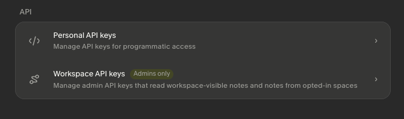
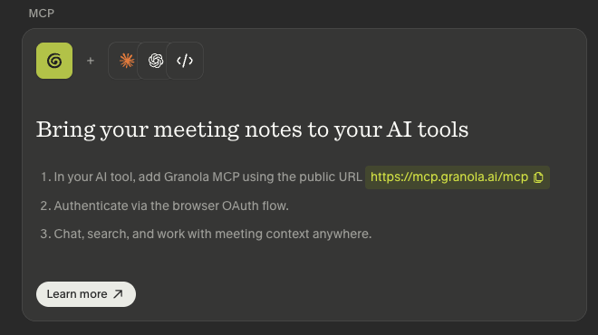

# Granola CLI

**Search, export, and analyze every Granola meeting across all your calls  -  attendee timelines, talk-time roll-ups, and transcript search from an offline local mirror.**

granola-cli sources every meeting from Granola’s public surfaces  -  the public REST API (`public-api.granola.ai/v1`) for the meeting list, speaker-labeled transcripts, AI summaries, folders, and attendees, plus Granola’s official MCP server (`mcp.granola.ai`) for the raw private/human notes the REST API omits  -  and syncs all of it into a local SQLite store. That store powers the cross-meeting queries Granola.ai’s web app and existing community CLIs cannot answer: memo run, memo queue, attendee timeline, attendee brief, talktime, and duplicates scan are offline data joins no per-meeting tool produces. The sealed desktop store (`cache-v6.json.enc`) is app-private on Granola v7.4x+ and is not used. Works offline once synced; agent-native JSON by default.

Created by [@DamienStevens](https://github.com/DamienStevens) (Damien Stevens).

## Install

This CLI ships as a Claude Code Skill and MCP server in [Servosity/msp-skills](https://github.com/Servosity/msp-skills). The installer downloads the `granola-cli` and `granola-mcp` binaries into `~/.local/bin` (macOS / Linux) or `%LOCALAPPDATA%\Programs\msp-skills` (Windows). It does not register the skill with your agent and writes no MCP client config - see [mcp-install.md](./mcp-install.md) for that wire-up.

1. macOS / Linux:
   ```bash
   bash <(curl -fsSL https://raw.githubusercontent.com/Servosity/msp-skills/main/skills/granola/install.sh)
   ```
2. Windows (PowerShell):
   ```powershell
   iwr -useb https://raw.githubusercontent.com/Servosity/msp-skills/main/skills/granola/install.ps1 | iex
   ```
3. Verify: `granola-cli --version`
4. Ensure `~/.local/bin` (macOS / Linux) or `%LOCALAPPDATA%\Programs\msp-skills` (Windows) is on `$PATH`.

If `--version` reports "command not found" after install, the install step did not put the binary on `$PATH`. Do not proceed until verification succeeds.

### Pre-built binary

Download a pre-built binary for your platform from the [latest release](https://github.com/Servosity/msp-skills/releases?q=granola). On macOS, clear the Gatekeeper quarantine: `xattr -d com.apple.quarantine <binary>`. On Unix, mark it executable: `chmod +x <binary>`.

<!-- pp-hermes-install-anchor -->
## Install for Hermes

From the Hermes CLI:

```bash
hermes skills install Servosity/msp-skills/skills/granola --force
```

Inside a Hermes chat session:

```bash
/skills install Servosity/msp-skills/skills/granola --force
```

Hermes [speaks MCP natively](https://hermes-agent.nousresearch.com), so it can also use the `granola-mcp` server directly - same install path, same environment variables. Restart the Hermes session or gateway if the newly installed skill is not visible immediately.

## Install for OpenClaw

Tell your OpenClaw agent (copy this):

> Install the granola skill from https://github.com/Servosity/msp-skills/tree/main/skills/granola. The skill defines how its required CLI (`granola-cli`) can be installed via the `openclaw:` frontmatter block.

OpenClaw isn't generally available yet; the frontmatter wiring is pre-shipped and will activate the moment OpenClaw launches.

## Use with Claude Desktop

This CLI ships an [MCPB](https://github.com/modelcontextprotocol/mcpb) bundle  -  Claude Desktop's standard format for one-click MCP extension installs (no JSON config required).

To install:

1. Download the `.mcpb` for your platform from the [latest release](https://github.com/Servosity/msp-skills/releases?q=granola).
2. Double-click the `.mcpb` file. Claude Desktop opens and walks you through the install.
3. Fill in `GRANOLA_API_KEY` when Claude Desktop prompts you.

Requires Claude Desktop 1.0.0 or later. One bundle covers macOS (universal), Linux (amd64), and Windows (amd64); on other platforms, use the manual config below.

<details>
<summary>Manual JSON config (advanced)</summary>

If you can't use the MCPB bundle (older Claude Desktop, unsupported platform), install the MCP binary and configure it manually.


Install the MCP binary from this CLI's published public-library entry or pre-built release.

Add to your Claude Desktop config (`~/Library/Application Support/Claude/claude_desktop_config.json`):

```json
{
  "mcpServers": {
    "granola": {
      "command": "granola-mcp",
      "env": {
        "GRANOLA_API_KEY": "<your-key>"
      }
    }
  }
}
```

</details>

## Authentication

Two surfaces. The public REST API key is the floor that powers everything; Granola’s official MCP is an optional add-on that only supplies your private notes. Neither is “one or the other”  -  the key is required, the MCP is additive.

### `GRANOLA_API_KEY`  -  public REST API (required)

Powers everything: `sync`, meetings, transcripts, summaries, folders, attendees, talk-time, search, and the MEMO pipeline’s transcript + summary. Get it from **Granola Settings → API**. A **Personal** key exposes your own notes; a **Workspace** key exposes workspace-visible notes  -  both work identically with this CLI. Set it in your environment:

```bash
export GRANOLA_API_KEY=<your-key>
```



*Granola Settings → API. Either a **Personal** key (your notes) or a **Workspace** key (workspace-visible notes) works  -  the CLI treats them identically.*

### Granola’s official MCP  -  private/human notes (optional, additive)

Granola’s REST API omits your raw private/human notes; Granola’s official MCP server (`https://mcp.granola.ai`) is the only source for them. Connecting it is optional  -  everything else works without it, and the commands that show human notes (`notes-show`, `memo`, `extract`, `export`) simply omit the human-notes section until you connect. Connect once, then verify:

```bash
granola-cli mcp-auth login     # browser OAuth (PKCE); tokens saved to the macOS Keychain, never on disk
granola-cli mcp-auth status    # is it connected?
granola-cli mcp-auth verify    # confirm private notes are reachable end-to-end
granola-cli enrich             # add private notes to meetings you already synced (enrich --full for all)
```



*Granola’s official MCP setup. `mcp-auth login` connects the CLI to `mcp.granola.ai` as an OAuth client so it can fetch the private notes REST omits.*

> **Two different MCP servers  -  don’t conflate them.** This CLI *exposes its own* MCP server (`granola-mcp`, the agent-native surface that mirrors its commands as tools  -  see [Use with Claude Desktop](#use-with-claude-desktop) above) **and** separately *consumes Granola’s official* MCP server (`mcp.granola.ai`, an external service run by Granola) as an OAuth client to fetch your private notes. `mcp-auth` connects the latter; it has nothing to do with the former.

> **The sealed desktop store is unused.** On Granola v7.4x+ the local store (`~/Library/Application Support/Granola/cache-v6.json.enc`) sits behind Granola’s own macOS Keychain access group and its internal API token behind the same wall, so no third-party binary can decrypt it. This CLI does not try  -  all data flows through the public REST API and the official MCP instead.

## Quick Start

```bash
# Confirm the REST key resolves and show MCP + local-store status.
granola-cli doctor --json

# Populate the local SQLite store from the public REST API
# (meeting list + folders + per-meeting transcripts/attendees;
#  also pulls private notes if Granola's MCP is connected).
granola-cli sync

# Optional: connect Granola's official MCP to add your private/human notes,
# then pull them into meetings you already synced (later commands also
# backfill them, 25 meetings at a time).
granola-cli mcp-auth login
granola-cli enrich

# What’s synced but not yet MEMO’d this week.
granola-cli memo queue --since 7d --root ~/Documents/meeting-transcripts --json

# Run the full MEMO pipeline on every meeting since yesterday.
granola-cli memo run --since 24h --to ~/Documents/meeting-transcripts --root ~/Documents/meeting-transcripts --json

# Every meeting with Alice in the last 60 days, oldest first.
granola-cli attendee timeline alice@example.com --since 60d --json --select id,title,started_at

# Your share of the talking across this week's meetings  -  the time-defrag retro input.
granola-cli talktime --by participant --since 7d --json

```

## Unique Features

These capabilities aren't available in any other tool for this API.

### MEMO pipeline
- **`memo run`**  -  Run the preflight → extract pipeline on one meeting or every new meeting since a timestamp, emitting the MEMO three-file artifact and an ndjson run-state ledger.

  _Replaces the per-meeting shell loop that drives the MEMO pipeline  -  one call, one ndjson stream, agent-readable._

  ```bash
  granola-cli memo run --since 24h --to ~/Documents/meeting-transcripts --root ~/Documents/meeting-transcripts --json
  ```
- **`memo queue`**  -  List every meeting whose transcript is in the local store but whose MEMO triple is not yet on disk.

  _Answers the daily question “what’s still un-MEMO’d?” without the user opening Granola at all._

  ```bash
  granola-cli memo queue --since 7d --root ~/Documents/meeting-transcripts --json
  ```

### Transcript source labels, exit codes, and drift

Granola's public REST API labels each transcript segment `speaker.source`:
**`microphone`** (you, the near end) and **`speaker`** (the far end). The sealed
pre-7.4x desktop cache used `system`/`mixed`; that store is app-private on
Granola v7.4x+ and unreadable by any third-party tool, so those labels are
treated as **unrecognized** rather than silently counted.

`preflight` exit codes:

| Exit | Meaning |
| --- | --- |
| `0` | ready to extract |
| `2` | no transcript, or below the threshold (needs >= 5 `microphone` segments AND >= 10 CLASSIFIED segments) |
| `3` | a file in `--root` already covers this meeting - the meeting id is in its filename, or a file whose name carries the meeting title declares that id (a `Meeting ID:` line, a `Meeting Link:` to notes.granola.ai, or frontmatter `id:`), or the file declares no comparable id and is named for this meeting's day and exact title (`<YYYY-MM-DD> <Title> - <Org> - Full.md`) - **or** the meeting is unknown to both the local store and the Granola API (preflight first tries to fetch a meeting sync has not enriched yet; stderr says which case it is). A same-title file from a different day (a recurring meeting), or a file whose name only contains the title, is reported as `title_collision` and does not block. `--root` defaults to `~/Documents/Dev/meeting-transcripts`; pass the folder your memos actually live in. |
| `4` | transcript source labels are unrecognized, so the gate cannot classify the transcript -- upstream changed its grammar. **Not the same as exit 2:** the text is probably there, the channels just can't be read. |
| `5` | the meeting is not in the local store and the Granola API could not be asked (no key configured) or refused or failed the lookup (bad key, outage). The meeting may exist; set or fix the key, or retry. |

Unclassified segments never count toward the threshold, so an upstream relabel
cannot manufacture a passing verdict.

**`one_sided`** is reported, never gated. A solo voice memo legitimately has zero
far-end segments and passes. The key is **omitted** when any label failed to
classify, because a relabelled far end and a genuine solo memo are then
indistinguishable -- absence means "cannot tell", not `false`.

`memo run` status values: `new`, `duplicate`, `missing_transcript` (absent OR
below threshold), `unknown_source_label` (grammar drift, distinct from missing),
`skipped`, `error`. Drift is reported in `unknown_sources` even on a memo that
succeeded.

`memo queue` emits a **union**: ready-to-memo rows, plus diagnostic rows carrying
`status:"skipped"` and `reason` for meetings whose labels could not be
classified. Filter diagnostics out when building a work list:

```bash
granola-cli memo queue --last 7d | jq 'select(.status != "skipped")'
```

They exist so a fleet-wide relabel cannot present as an empty queue.

### Credentials

Pass the token via the **`GRANOLA_API_KEY` environment variable**, or save it once
with `auth set-token`, which reads the secret from stdin (or from `GRANOLA_API_KEY`)
and refuses a command-line argument, so it never lands in shell history or `ps`
output:

```bash
printf %s "$TOKEN" | granola-cli auth set-token
```

### Attendee intelligence
- **`attendee timeline`**  -  Every meeting with a given attendee, ordered oldest→newest, with title and date per row.

  _Pre-call prep in one command; surfaces the conversation arc with a single person across months of meetings._

  ```bash
  granola-cli attendee timeline alice@example.com --since 60d --json --select id,title,started_at
  ```
- **`attendee brief`**  -  Pulls the last N meetings with an attendee and stitches together their real human notes plus real AI panel summaries  -  no synthesis.

  _Eliminates the click-each-meeting copy-paste that account leads do before every external call._

  ```bash
  granola-cli attendee brief alice@example.com --last 3 --json
  ```

### Transcript analytics
- **`talktime`**  -  Per-segment-source talk-time for one meeting  -  microphone (you) vs system (everyone else) in minutes.

  _Granola’s REST API does not report per-segment confidence, so `confidence_avg` is always 0; the mic vs system split is the input to “am I talking too much” retros._

  ```bash
  granola-cli talktime not_06Yq6JtogRihEr --json
  ```
- **`talktime --by participant`**  -  Lifts the per-source talk-time aggregation across N meetings since a date  -  your share of the talking (your microphone) versus everyone else, over time. The public API names no meeting owner, so this is a you-versus-everyone split, not a per-person ranking.

  _Time-defrag retro input that no per-meeting tool can produce._

  ```bash
  granola-cli talktime --by participant --since 7d --json
  ```

### Pipeline hygiene
- **`duplicates scan`**  -  Groups the local store and a meeting-transcripts repo by meeting id (from the store, the file name, or the id a file declares); a file with no id is matched by title plus the date in its name, and only when exactly one stored meeting fits.

  _Repos accumulate near-duplicate files when meetings are re-extracted; this returns the dupe groups for cleanup._

  ```bash
  granola-cli duplicates scan --root ~/Documents/meeting-transcripts --json
  ```

### REST + MCP backbone
- **`enrich`**  -  Populate meetings, transcripts, and attendees from the public REST detail endpoint (`/v1/notes/{id}?include=transcript`). Needed on Granola v7.4x+ where the desktop cache is sealed; `sync` runs it for you, or call it directly with `--full` for the whole library.

  _Hydrates the rich local tables straight from `public-api.granola.ai`  -  no desktop app, no decryption._

  ```bash
  granola-cli enrich --full --json
  ```
- **`mcp-auth login`**  -  Connect Granola's official MCP (OAuth + PKCE)  -  the only source of the private/human notes the public REST API omits.

  _Adds the one stream REST cannot return; tokens land in the macOS Keychain, never on disk._

  ```bash
  granola-cli mcp-auth login
  ```
- **`notes-show`**  -  Show only the human-typed notes (rich-text notes rendered to markdown) for a meeting  -  the human stream, addressable separately from AI panels and transcript.

  _Isolates what a person actually wrote from the AI summary, so agents can route the two streams differently._

  ```bash
  granola-cli notes-show not_06Yq6JtogRihEr --json
  ```

## Usage

Run `granola-cli --help` for the full command reference and flag list.

## Commands

This CLI exposes 35+ commands. Use `granola-cli --help` for the canonical tree and `granola-cli which "<capability>"` to find the right command from natural language. Grouped overview:

| Group | Commands |
|-------|----------|
| **MEMO pipeline** | `memo run`, `memo queue`, `preflight`, `extract` |
| **Meetings** | `meetings list / get / fetch-batch`, `show` |
| **Three streams** | `notes-show`, `panel get`, `transcript get` |
| **Export** | `export <id> -o FILE`, `export-all --since DATE -o DIR` |
| **Cross-meeting analytics** | `attendee timeline / brief`, `talktime`, `stats frequency / duration / attendees / calendar`, `collect`, `duplicates scan` |
| **Granola entities** | `folders` |
| **Public API mirrors** | `notes list / get`, `folders` (require `GRANOLA_API_KEY`) |
| **Sync / system** | `sync`, `enrich`, `sync-api`, `mcp-auth login / status / verify / logout`, `doctor`, `auth setup / status / set-token / logout`, `which`, `agent-context`, `version` |

The REST + MCP model adds three commands worth calling out:

- **`sync`**  -  one command to populate the local SQLite store from the public REST API (meeting list + folders), enriching meetings/transcripts/attendees from the per-meeting detail endpoint; also pulls private notes when Granola’s MCP is connected. `--full` enriches the entire library (default: 50 most recent).
- **`enrich [--limit N | --full]`**  -  the detail/transcript/notes enrichment step on its own. `sync` runs it for you; call it directly to refresh more meetings (`--full` for the whole library).
- **`mcp-auth login | status | verify | logout`**  -  connect and inspect Granola’s official MCP for private/human notes. `verify` confirms those notes are reachable end-to-end.

## Output Formats

```bash
# Human-readable table (default in terminal, JSON when piped)
granola-cli folders

# JSON for scripting and agents
granola-cli folders --json

# Filter to specific fields
granola-cli folders --json --select folders.id,folders.name

# Dry run  -  show the request without sending
granola-cli folders --dry-run

# Agent mode  -  JSON + compact + no prompts in one flag
granola-cli folders --agent
```

## Agent Usage

This CLI is designed for AI agent consumption:

- **Non-interactive** - never prompts, every input is a flag
- **Pipeable** - `--json` output to stdout, errors to stderr
- **Filterable** - `--select id,name` returns only fields you need
- **Previewable** - `--dry-run` shows the request without sending
- **Read-only against Granola**  -  every command inspects, exports, syncs, or analyzes; it never mutates remote Granola state. The only writes are local: saved credentials (`auth set-token`), Granola-MCP tokens (`mcp-auth login`), MEMO/export files on disk, and the local teach/learning store
- **Offline-friendly** - `sync` fills the local SQLite store; `meetings list --query <text>` matches titles, notes, and transcript text there
- **Agent-safe by default** - no colors or formatting unless `--human-friendly` is set

Exit codes: `0` success, `2` usage error, `3` not found, `4` auth error, `5` API error, `7` rate limited, `10` config error.

## Auto-Refresh

Every command auto-refreshes the local store as its first action. You do not need to run `granola-cli sync` before `meetings list`, `panel get`, or any other read.

Auto-refresh pulls from the public REST API (`public-api.granola.ai`) when `GRANOLA_API_KEY` is set  -  the meeting list and folders plus per-meeting transcript/attendee enrichment  -  and, when Granola’s official MCP is connected, your private/human notes. The sealed desktop store (`cache-v6.json.enc`) is app-private on Granola v7.4x+, so that surface is a no-op. When no API key is configured, auto-refresh is a silent no-op and the underlying command produces its own auth error.

A one-line provenance summary lands on stderr in interactive mode: `auto-refresh: api=ok (1.2s, 47 rows)`. It is suppressed under `--agent`, `--json`, `--compact`, `--quiet`, and when stderr is piped  -  so agent and CI consumers see no chatter on stdout or stderr.

Opt out with `--no-refresh` for a single command, `GRANOLA_NO_AUTO_REFRESH=1` for a shell session or CI job, or by saving a profile with `--no-refresh` (`granola-cli profile save "fast" --no-refresh`). The skip list (commands that never auto-refresh) is `sync`, `sync-api`, `auth`, `doctor`, `help`, `version`, `completion`, `agent-context`, `profile`, `feedback`, `which`. <!-- cli-claims:ignore -->Run `granola-cli agent-context --json` to see the full contract as structured JSON.

Auto-refresh reads from Granola’s public REST API; it does not poke the desktop app. The freshness ceiling is whatever Granola has published to your account through the REST API and MCP.

## Health Check

```bash
granola-cli doctor
```

`doctor` verifies your setup end-to-end: it makes a real call against the public REST API to confirm `GRANOLA_API_KEY` works, reports whether Granola’s official MCP is connected (so private/human notes are reachable), and does not read the sealed desktop store at all. It also shows local-store freshness and row counts. Add `--json` for machine-readable output or `--fail-on error` to exit non-zero on failure.

## Configuration

Config file: `~/.config/granola-cli/config.toml`

Static request headers can be configured under `headers`; per-command header overrides take precedence.

Environment variables:

| Name | Kind | Required | Description |
| --- | --- | --- | --- |
| `GRANOLA_API_KEY` | per_call | Yes | Public REST API key from Granola Settings → API (Personal or Workspace). Powers `sync` and every data command. |

Granola’s official MCP (for private/human notes) is connected separately with `granola-cli mcp-auth login` (browser OAuth); its tokens live in the macOS Keychain, not in an environment variable.

## Troubleshooting
**Authentication errors (exit code 4)**
- Run `granola-cli doctor` to check credentials
- Verify the environment variable is set: `echo $GRANOLA_API_KEY`
**Not found errors (exit code 3)**
- Check the resource ID is correct
- Run the `list` command to see available items

### API-specific

- **doctor says `api: ERROR base_url is not the Granola public API root`**  -  `GRANOLA_BASE_URL` (or `base_url` in the config file) points somewhere that is not the Granola API. Unset it to use `https://public-api.granola.ai`.
- **Authentication error (exit code 4) / empty results**  -  Make sure `GRANOLA_API_KEY` is set (`echo $GRANOLA_API_KEY`); get a Personal or Workspace key from Granola Settings → API. Run `granola-cli doctor` to confirm the key reaches the REST API.
- **Human/private notes are missing from `notes-show`, `memo`, `extract`, or `export`**  -  The public REST API omits raw private notes. Connect Granola’s official MCP with `granola-cli mcp-auth login`, then `granola-cli mcp-auth verify` to confirm they’re reachable.
- **memo run --since reports duplicate_of**  -  A memo for that meeting already exists: `full_<id>.md` in `--to`, or a file in `--root` that carries the meeting id or the same title and day. Point `--root` at the folder your memos live in, or move the existing file out of the way.
- **Transcript missing for a recent meeting**  -  Granola may not have processed it server-side yet, or it isn’t in the synced window. Run `granola-cli sync` (or `granola-cli enrich --full` to enrich the entire library), then retry.
- **stats / talktime returns empty rows**  -  The local store is empty or stale. Run `granola-cli sync` to hydrate it from the REST API (add `--full` to pull the whole library). Confirm `GRANOLA_API_KEY` is set via `granola-cli doctor`. If you bypassed auto-refresh with `--no-refresh` or `GRANOLA_NO_AUTO_REFRESH=1`, run `granola-cli sync` manually.

---

## Sources & Inspiration

This CLI was built by studying these projects and resources:

- [**GranolaMCP (pedramamini)**](https://github.com/pedramamini/GranolaMCP)  -  Python
- [**granola-mcp (chrisguillory)**](https://github.com/chrisguillory/granola-mcp)  -  Python
- [**reverse-engineering-granola-api (getprobo)**](https://github.com/getprobo/reverse-engineering-granola-api)  -  Python
- [**granola-claude-mcp (cobblehillmachine)**](https://github.com/cobblehillmachine/granola-claude-mcp)  -  Python
- [**granola-mcp (btn0s)**](https://github.com/btn0s/granola-mcp)  -  TypeScript
- [**granola-mcp-server (EoinFalconer)**](https://github.com/EoinFalconer/granola-mcp-server)  -  TypeScript
- [**granola-ai-mcp-server (maxgerlach1)**](https://github.com/maxgerlach1/granola-ai-mcp-server)  -  TypeScript

Generated by [CLI Printing Press](https://github.com/mvanhorn/cli-printing-press)
