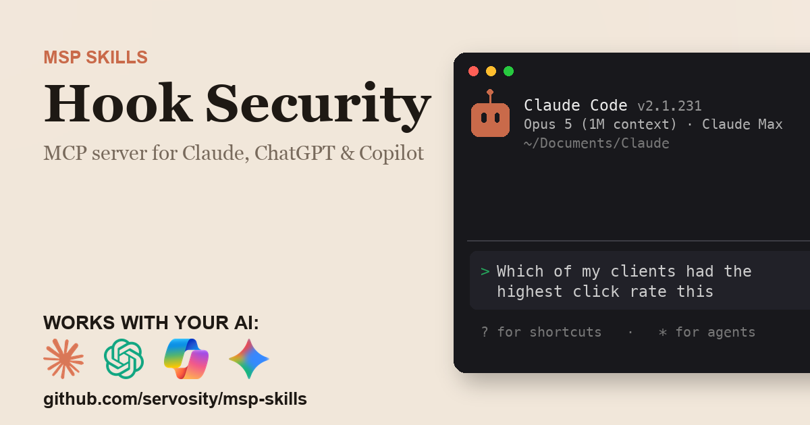

# Hook Security + AI - for ChatGPT, Claude, GitHub Copilot, Microsoft 365 Copilot, Gemini, and any agent that speaks MCP

> Unofficial. Community-built Claude Code Skill and MCP server for the Hook Security
> API. Not affiliated with, endorsed by, or sponsored by Hook Security Inc.

<!-- media:start -->
<p align="center">
  <a href="https://msp-skills.compoundingteams.com/skills/hook-security/">
    
  </a>
</p>
<p align="center"><sub><a href="https://msp-skills.compoundingteams.com/skills/hook-security/">Full skill page</a> - install, outcomes, safety model.</sub></p>
<!-- media:end -->

Phishing click rates, who clicked and has not finished training, overdue training and QBR numbers, across every client. Works with the AI you already use - **ChatGPT** (Plus/Pro+), **Claude Desktop**, **Codex**, **Claude Code**, **Claude Cowork**, and **GitHub Copilot** - plus **Microsoft 365 Copilot / Copilot Studio** and **Google Gemini** via the remote path. Free, open source, runs on your laptop. Built for MSP owners. No code required.

## Works with your agent

The six agents MSP owners actually use (self-serve, works today):

| Your AI agent | How to install the Hook Security skill |
| --- | --- |
| **Claude Desktop** | Run installer, then **Settings > Extensions** to register `hook-security-mcp` (no JSON editing). |
| **ChatGPT** (paid plans) | Run installer, host `hook-security-mcp` over HTTPS with `HOOK_SECURITY_MCP_HTTP_TOKEN` set, then register it as a Developer Mode connector if your connector settings can send the bearer token. |
| **Codex CLI** | Paste the install prompt below. |
| **Claude Code** | Paste the install prompt below. |
| **Claude Cowork** | Paste the install prompt below. |
| **GitHub Copilot** (VS Code) | Run installer, add `hook-security-mcp` to `mcp.json` under the `servers` key, then pick **Agent** mode. |

For ChatGPT, run `hook-security-mcp --transport http` with `HOOK_SECURITY_MCP_HTTP_TOKEN` set, on an HTTPS host; every request sends that token. See [mcp-install.md](./mcp-install.md).

### Also for the Microsoft and Google stacks

Big install base, but an honest heads-up: these are the **remote / enterprise** path, not the local binary you just installed.

| Agent | What it takes |
| --- | --- |
| **Microsoft 365 Copilot / Copilot Studio** | **Not self-serve.** Host `hook-security-mcp` over HTTPS with `HOOK_SECURITY_MCP_HTTP_TOKEN` set, then wire it into Copilot Studio (**Tools > Add a tool > Model Context Protocol > Server URL**) or a declarative agent, if it can send the bearer token. Needs a Copilot Studio license + tenant admin. See [mcp-install.md](./mcp-install.md). |
| **Google Gemini** | **Gemini CLI** is local - same as Claude Code. The **Gemini app** is remote - same HTTPS path as ChatGPT. See [mcp-install.md](./mcp-install.md). |

> **Skill-native agents (also covered):** [Hermes](https://hermes-agent.nousresearch.com) and [OpenClaw](#install-for-openclaw) read this skill's `SKILL.md` directly *and* speak MCP - see their install sections below. Also works with Cursor, Windsurf, Cline, Continue.dev, and Zed via MCP. Full per-tool wire-up: **[docs/which-agent.md](../../docs/which-agent.md)**.

> **Run more than one agent?** Install across all 51+ supported agents in one command: `npx skills add Servosity/msp-skills@latest` (requires Node.js, then run the per-skill installer for the CLI/MCP binaries). See [docs/which-agent.md](../../docs/which-agent.md#install-across-all-your-agents-at-once).

## Install in 60 seconds

### Fastest for Claude Desktop - one-click `.mcpb`

[**Download Hook Security MCP (.mcpb)**](https://github.com/servosity/msp-skills/releases/download/hook-security-v0.1.0/hook-security-mcp.mcpb) - then open **Claude Desktop > Settings > Extensions** and select the file. One click, no JSON, no shell. (Browse every Hook Security release on the [releases page](https://github.com/servosity/msp-skills/releases?q=hook-security).)

Prefer the Claude Code plugin? Add the marketplace once, then install - works immediately, no directory listing required:

```
/plugin marketplace add Servosity/msp-skills
/plugin install hook-security@msp-skills
```

### Path A - paste one prompt into your AI agent (recommended)

Copy this into **Claude Code**, **Codex CLI**, or **Claude Cowork**:

> Install the Hook Security Skill and MCP server from Servosity/msp-skills in this agent workspace. If this workspace uses a POSIX shell (macOS, Linux, WSL, or Bash), run `bash <(curl -fsSL https://raw.githubusercontent.com/Servosity/msp-skills/main/skills/hook-security/install.sh)`. If it uses Windows PowerShell, run `iwr -useb https://raw.githubusercontent.com/Servosity/msp-skills/main/skills/hook-security/install.ps1 | iex`. Then authenticate per the README and run `hook-security-cli --help` to explore.

The same prompt works in any agent that can run shell.

### Path B - run the installer yourself

**Windows (PowerShell):**

```powershell
iwr -useb https://raw.githubusercontent.com/Servosity/msp-skills/main/skills/hook-security/install.ps1 | iex
```

**macOS / Linux:**

```bash
bash <(curl -fsSL https://raw.githubusercontent.com/Servosity/msp-skills/main/skills/hook-security/install.sh)
```

The installer drops both `hook-security-cli` (the CLI) and `hook-security-mcp` (the MCP server) into your user bin path. Claude Code, Codex, and Cowork discover the Skill via `SKILL.md` in this directory.

Verify:

```bash
hook-security-cli --version
```

### Upgrade to the latest version

The installer always fetches the current release - re-run it to upgrade:

**macOS / Linux:**

```bash
bash <(curl -fsSL https://raw.githubusercontent.com/Servosity/msp-skills/main/skills/hook-security/install.sh)
```

**Windows (PowerShell):**

```powershell
iwr -useb https://raw.githubusercontent.com/Servosity/msp-skills/main/skills/hook-security/install.ps1 | iex
```

Claude Desktop `.mcpb` users: download the latest `.mcpb` (top of this section) and re-select it in **Settings > Extensions**. Claude Code plugin users: `/plugin update hook-security@msp-skills`.

### Add to Claude Desktop, GitHub Copilot, Gemini CLI, Microsoft 365 Copilot, or another MCP client

After the installer runs, see **[mcp-install.md](./mcp-install.md)** and **[docs/which-agent.md](../../docs/which-agent.md)** for the per-agent wire-up - one section per agent, including the GitHub Copilot `servers` key and the remote Microsoft 365 Copilot / Copilot Studio path. Claude Desktop's Settings > Extensions panel is the simplest path; the MCP config block (for users who prefer editing JSON) is documented in mcp-install.md.

<!-- pp-hermes-install-anchor -->
### Install for Hermes

From the Hermes CLI:

```bash
hermes skills install servosity/msp-skills/skills/hook-security --force
```

Inside a Hermes chat session:

```
/skills install servosity/msp-skills/skills/hook-security --force
```

Hermes [speaks MCP natively](https://hermes-agent.nousresearch.com), so it can also use the `hook-security-mcp` server directly - same install path, same env vars.

### Install for OpenClaw

Tell your OpenClaw agent (copy this):

> Install the hook-security skill from https://github.com/servosity/msp-skills/tree/main/skills/hook-security. The skill defines how its required CLI (`hook-security-cli`) can be installed via the `openclaw:` frontmatter block.

OpenClaw isn't generally available yet; the frontmatter wiring is pre-shipped and will activate the moment OpenClaw launches.

### Authenticate

Set the credentials the CLI needs (from your Hook Security portal):

```bash
HOOK_SECURITY_API_KEY=<value> hook-security-cli doctor
```

```powershell
$env:HOOK_SECURITY_API_KEY="<value>"; hook-security-cli doctor
```

`doctor` checks config and paths, then sends one authenticated read to `GET /v1/organizations`, and reports whether Hook accepted the key.


## What this skill does

| Question your MSP keeps asking | Command | Reads |
| --- | --- | --- |
| Which clients have the highest click rate? | `hook-security-cli client-risk --top 10` | Live |
| Who clicked in this campaign and has not finished training? | `hook-security-cli clicked-untrained --campaign cmp_88213` | Live |
| Who at this client clicked since July and has not finished? | `hook-security-cli clicked-untrained --org org_4521 --since 2026-07-01` | Live |
| Which clients have people overdue on training? | `hook-security-cli overdue-training --counts-only` | Live |
| What are this client's QBR numbers? | `hook-security-cli qbr org_4521 --days 90` | Live |
| Who reported this simulation? | `hook-security-cli campaigns results list-campaign cmp_88213 --outcome reported --all` | Live or local copy |
| How many billable users did each account have in October? | `hook-security-cli billing --month 2026-10 --all` | Live or local copy |

`client-risk` needs an MSP key. "Finished" means every enrollment that was not cancelled is completed; completion dates are not compared with click dates, and courses are not matched to campaigns. List commands return one page unless you pass `--all`. `search` and `sql` read the local copy, so run `hook-security-cli sync` first or they answer empty.

Full command reference: [guide.md](./guide.md). For the AI-agent operating contract (`--agent`, `--dry-run`, when to confirm before mutating), see [AGENTS.md](./AGENTS.md).

## What makes this different

Hook has its own [remote MCP connection](https://www.hooksecurity.co/blog/hook-mcp-server), and it is the shortest path if you only want to chat with your data. This connector runs on your computer and adds what a chat session does not give you: a command line for scripts and scheduled reports, an optional local SQLite copy for `search` and `sql`, and fixed commands whose output has the same fields every run.

`clicked-untrained` checks click results against enrollments. `client-risk` computes a fleet click rate from total clicks over total sent, never an average of client rates. `qbr` combines the organization, its summary, its newest campaigns and its overdue training, and fails rather than leave a section out. Each answer reports what it could not count, such as a client Hook marks `too_large` or a scan that stopped at `--max-scan-pages`.

## The pain this closes

Hook's [own announcement](https://www.hooksecurity.co/blog/hook-mcp-server) says the answers are "spread across a campaign page, a report and a training list", and describes the MSP need as "one question across every client, instead of opening each one." Its [QBR template](https://www.hooksecurity.co/blog/msp-qbr-template-security-awareness-results-15-minutes) asks for click rate, training completion and report rate with trends, for every client, every quarter.

See [pain-point.md](./pain-point.md) for the longer narrative.

## Frequently asked questions

### Does this work with ChatGPT?

Yes, on **Plus, Pro, Team, Business, Enterprise, and Education** plans (Free tier does not yet expose Developer Mode). ChatGPT connects to **remote** MCP servers over HTTPS, not local stdio binaries. The Hook Security MCP server runs locally over stdio by default. Its HTTP mode (`hook-security-mcp --transport http`) serves `http://127.0.0.1:7777/mcp`, refuses to start until `HOOK_SECURITY_MCP_HTTP_TOKEN` is set, requires `Authorization: Bearer <token>` on every request, and needs `--tls-cert`/`--tls-key` for any other address. See [mcp-install.md](./mcp-install.md). Step-by-step in [mcp-install.md](./mcp-install.md).

### Does this work with Codex, Cursor, Windsurf, Cline, Copilot, or Gemini?

Yes - all of them speak MCP. Cross-tool install commands are in the matrix above and the deep-dive in [docs/which-agent.md](../../docs/which-agent.md).

### Do I need to know how to code?

No. The recommended install is to paste one sentence into Claude Code or Codex - your agent reads `SKILL.md` and does the install. The fallback is a one-line installer per OS (bash or PowerShell). Neither path requires writing code. You'll enter your Hook Security credentials once.

### Is my Hook Security data safe?

The CLI, MCP server and local copy all run on **your machine**, and your API key goes only to Hook. What a command returns goes to the AI you use, including people's names and emails on `clicked-untrained` and `overdue-training`; use `overdue-training --counts-only` to leave those out. See [governance.md](./governance.md).

### How is this different from Hook's own MCP connection?

Hook's [MCP connection](https://www.hooksecurity.co/blog/hook-mcp-server) is a remote server you add to your AI assistant. This is a Claude Code Skill and MCP server that run on your computer, with a command line you can script, an optional local copy of the data, and fixed commands for the cross-client questions. Both use the same kind of Hook API key.

### What kind of Hook API key do I need?

An admin creates one in Hook under Settings > API keys, and it is shown once. An MSP key reads the MSP and every client under it, including clients added later. An organization key reads only that organization, so client-risk needs an MSP key. Hook says keys are currently included in all paid plans on its new platform.

### Can the AI change anything in Hook?

No. Hook's API is read-only, so no command or MCP tool can change campaigns, training or people in Hook.

### Does it store my users' names and email addresses?

Read responses are saved on your computer in a short-lived cache, and sync saves a local SQLite copy. Neither is encrypted, so they rely on your account permissions and disk encryption. Set HOOK_SECURITY_NO_LOCAL_DATA=1 to keep no local copy, and run local-data purge --yes to erase it. Names and emails a command returns are also sent to whichever AI you use.

### What does it cost?

Free. Apache-2.0 licensed. You pay only for whichever AI agent you use (Claude, ChatGPT, Codex, etc.), and that's billed by your AI provider, not by us.

## Safety model

| Tier | Examples | Recommended agent policy |
| --- | --- | --- |
| Read | `client-risk`, `clicked-untrained`, `overdue-training`, `qbr`, `organizations`, `campaigns`, `enrollments`, `people`, `groups`, `courses`, `billing`, `search`, `sql` | Allow |
| Local files only | `sync`, `export`, the `teach` commands, `local-data purge` | Allow `sync` and `export`; a person runs `local-data purge --yes` |
| Credential | `auth set-token`, `auth logout` | Human-in-the-loop only |

Nothing here can change Hook: its API is read-only.

Hook's [integrations page](https://www.hooksecurity.co/integrations) advertises webhooks, but its API reference and OpenAPI document define no webhook contract, so this connector has no receiver.

The strongest control is the **key's coverage**: an organization key reads one organization, an MSP key reads every client under the MSP. Full details, including how to lock it down, are in [governance.md](./governance.md).

## Status

Beta. Built from Hook's published OpenAPI document and tested against a local fake server shaped from it. It has not yet been run against a live Hook account. MSPs can validate it against their own tenant in our weekly Build Sessions. RSVP at [compoundingteams.com/build-sessions](https://compoundingteams.com/build-sessions).

---

**Standards.** Conforms to the open [Agent Skills spec](https://agentskills.io) (Anthropic, Dec 2025; 40+ agents). MCP-compatible - works with any MCP-capable agent including [Hermes](https://hermes-agent.nousresearch.com). OpenClaw-ready (frontmatter pre-wired, awaiting OpenClaw launch).

Maintained by [Servosity](https://www.servosity.com). Apache-2.0 licensed. Built with [CLI Printing Press](https://github.com/mvanhorn/cli-printing-press). _Last updated: 2026-11-10._
